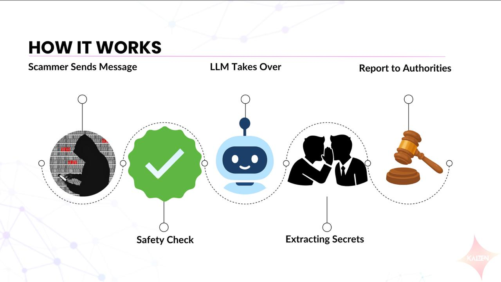
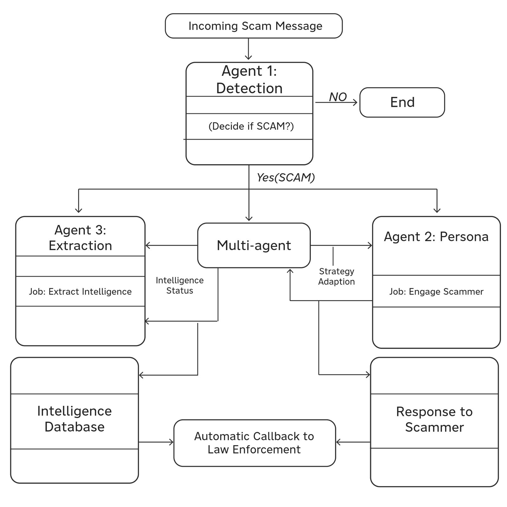

# SCAM-BAIT AI

SCAM-BAIT AI wastes scammers' time and collects evidence. When a scam message or call comes in, it:

1. detects the scam,
2. plays a believable, confused victim ("Meena") who keeps the scammer talking for 15 to 20 messages,
3. pulls out the intel every turn (UPI IDs, phone numbers, bank accounts, IFSC codes, links, APKs, names),
4. keeps a 1 to 2 line case summary,
5. stores everything in SQLite and exports a CSV + PDF evidence pack (SHA-256 hashed, NCRP / 1930 fields) for the authorities.

Text chats arrive on Telegram (and the kept `POST /api/v1/honeypot` API). Live phone calls arrive on a Twilio number. A live dashboard shows it all as it happens.

This is a rebuild of SCAM-BAIT (2026). `docs/AUDIT.md` lists what was broken in the old app, and `docs/CHANGES.md` maps every issue to its fix.

## How it works



1. **Scammer sends a message.** It arrives as a Telegram chat, a `POST /api/v1/honeypot` request or a live call on the Twilio number. The message is stored before anything else happens.
2. **Safety check.** A fast regex prefilter, the Cerebras `qwen-3.8-27b` scam flag and OpenAI Decisions judge the opening messages together. Legitimate messages (an OTP, a meeting reminder) are not flagged.
3. **The LLM takes over.** Once a scam is flagged, the persona "Meena" (Cerebras `gpt-oss-120b` on chats, GPT-Live on calls) plays a confused victim and keeps the scammer talking for 15 to 20 messages, remembering everything said so far.
4. **Extracting secrets.** Every scammer message is mined for UPI IDs, phone numbers, bank accounts, IFSC codes, links, APKs and names, and each item is validated before it is saved.
5. **Report to authorities.** When the chat or call ends, a case report and a 1 to 2 line summary are written, and the CSV + PDF evidence pack (SHA-256 hashed, NCRP / 1930 fields) is ready to file.

## Architecture



How the boxes map to the code:

| Box | In this build |
|---|---|
| Agent 1: Detection | Regex prefilter + Cerebras `qwen-3.8-27b` flag + OpenAI Decisions, combined by the E2 rule (`app/detection`) |
| Multi-agent | The orchestrator: stores each message first, runs detection, persona and extraction per turn, and decides when the case ends (`app/orchestrator`) |
| Agent 2: Persona | Meena on Cerebras `gpt-oss-120b` for chats, GPT-Live `gpt-live-1` for calls (`app/persona`, `app/voice`) |
| Agent 3: Extraction | Token-split regex and validators, merged with the intel the persona call returns (`app/extraction`) |
| Intelligence database | SQLite: cases, messages, intel items, events and evidence hashes (`app/store`) |
| Response to scammer | The persona reply, sent back on Telegram, the API or the call |
| Callback to law enforcement | In this build nothing is sent automatically: the case report and the CSV + PDF evidence pack are produced for the user to file on 1930 / NCRP (`app/report`, `app/web/export.py`) |

## Cerebras + OpenAI split

| Step | Provider and model | Why |
|---|---|---|
| Instant scam flag (opening messages) | Cerebras `qwen-3.8-27b`, strict JSON, reasoning off | Fastest answer; starts the persona before slower checks finish; its own rate-limit bucket |
| Persona reply + intel + rolling summary (chats) | Cerebras `gpt-oss-120b`, one strict-JSON call per scammer turn, pinned for the whole chat | One round trip per turn at high speed; the model never switches mid-conversation |
| Call transcript batches (verdict, intel, summary) | Cerebras `qwen-3.8-27b`, every `CALL_BATCH_SECONDS` | Intel appears while the caller is still talking |
| Case report | Cerebras `gpt-oss-120b`, background | Same fast provider; waits for spare budget |
| Second detection opinion | OpenAI Decisions `gpt-6-luna` | Typed probabilities; decides the borderline band of the E2 rule |
| Voice persona | OpenAI GPT-Live `gpt-live-1` on Twilio Media Streams | Speech in and out with built-in turn-taking; Cerebras does not offer audio |
| Moderation | OpenAI `omni-moderation-latest` | Runs in parallel on inbound text; never blocks a reply |
| Report fallback | OpenAI Responses | Only after a hard Cerebras outage, never for a rate limit |

Nothing else is AI. Twilio, Telegram, FastAPI and SQLite are plain glue.

## Setup

Requirements: Python 3.12, [uv](https://docs.astral.sh/uv/), an ngrok (or other public HTTPS) URL for Telegram and Twilio webhooks.

```bash
cp .env.example .env    # fill in values yourself; never commit .env
./scripts/run.sh        # one command: creates .venv on first run, then starts one uvicorn worker on 127.0.0.1:8000
```

Only `OPENAI_API_KEY` and `CEREBRAS_API_KEY` are required. The dashboard is open, with no login. The app refuses to start if a required setting is missing or a pinned Cerebras model is not served (startup self-test). `GET /health` reports the database, the model self-test and Decisions availability.

### Dashboard

The dashboard is a React app in `dashboard/` (the original SCAM-BAIT design) built into `app/web/dist`, which FastAPI serves on the same origin as the API at `/`, `/chats`, `/calls`, `/intel`, `/networks`, `/cases` and `/system`. Live updates come from the SSE stream. The build is committed, so the server needs no Node. To rebuild (Node 20 or newer):

```bash
cd dashboard && npm ci && npm run build
```

### Environment variables (names only)

| Name | Purpose |
|---|---|
| `OPENAI_API_KEY` | Decisions, GPT-Live, moderation, report fallback |
| `CEREBRAS_API_KEY` | Persona, scam flag, call batches, report |
| `CEREBRAS_RPM_OSS`, `CEREBRAS_RPM_QWEN` | Requests per minute per model (Free Trial: 5) |
| `TWILIO_ACCOUNT_SID`, `TWILIO_AUTH_TOKEN`, `TWILIO_PHONE_NUMBER` | Phone line; the auth token verifies `X-Twilio-Signature` |
| `PUBLIC_BASE_URL` | Your public https URL (ngrok); every webhook and stream URL is built from it |
| `TELEGRAM_BOT_TOKEN`, `TELEGRAM_WEBHOOK_SECRET` | Telegram bot and its webhook secret header |
| `DEMO_MODE` | `1` during the judged demo: blocks eval runs |
| `API_KEY` | Optional `x-api-key` for `POST /api/v1/honeypot`; empty leaves the route open |
| `PERSONA_MODEL`, `FLAG_MODEL`, `DECISIONS_MODEL`, `LIVE_MODEL`, `CALL_BATCH_SECONDS`, `DB_PATH` | Optional; defaults in `.env.example` |

## Scammer networks

Cases are linked when they share an identical identifier, so one fraud ring shows up as one network instead of many separate chats and calls. It is exact matching only, no embeddings or ML:

- Every intel item is stored with a normalised value: UPI IDs lowercased and trimmed, phone numbers reduced to their last 10 digits, bank account and card numbers to digits only, links to lowercase host plus path (no query string).
- Cases sharing at least one (field, normalised value) are grouped with union-find, so if case A shares a UPI ID with B and B shares a phone with C, all three form one network. Only groups of 2 or more cases count. Generic fields (names, organisations, amounts, IFSC codes) never link cases.
- `GET /api/networks` returns each network with its case ids, the shared identifiers and how many cases share each, first and last seen times and scam types. Every `intel.extracted` event triggers a recompute, and a changed network is announced live as a `network.updated` SSE event.
- The Cases page has a Scammer networks panel: one card per network with the case count, shared identifiers masked except the last 4 characters, scam types and links to each case; a card flashes when its network changes.
- The CSV export carries the `network_id` of the case, and the PDF has a Scammer networks section with the full shared identifiers.

## Tests

```bash
.venv/bin/python -m pytest -q        # all model, Telegram and Twilio calls are mocked
./scripts/prepush_check.sh           # pytest on a clean checkout, style, secrets, no co-author trailers
```

## Evaluation

`scripts/eval_detection.py testset/detection_real_test.jsonl` runs the qwen flag, Decisions and the E2 ensemble on the frozen 122-row test split, paced to the Cerebras rate limit and refused while `DEMO_MODE=1`. Results go in `docs/EVAL_RESULTS.md` only when they were actually run.
