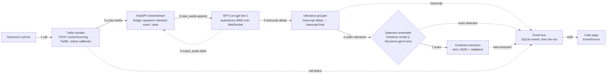
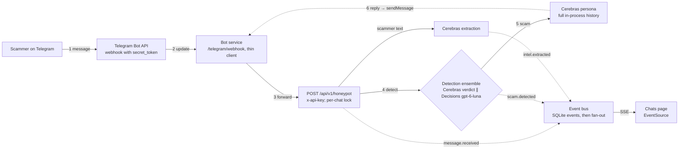

# SCAM-BAIT rebuild report

Old vs new: what the Feb–Sep 2026 SCAM-BAIT repo does, what the rebuild replaces it with on OpenAI and Cerebras only, and how and why. Cerebras-first, with a Cerebras + Decisions detection ensemble. For DevDay Exchange New Delhi, Sun 1 Nov 2026 (8 AM–8 PM IST). Updated 1 Nov 2026, 12:40 IST (simplified: one call mode, simple per-model rate limiter).

## Summary

The old SCAM-BAIT was a single pipeline: keyword rules, TF-IDF+SVM and a retired LLM for detection; a Cerebras/Groq persona whose state lived in Postgres or SQLite; regex extraction; and a Deepgram/ElevenLabs voice path that never answered. Its results went to a hackathon grading endpoint. The rebuild has three cooperating agents on OpenAI and Cerebras only, with Cerebras as the centrepiece of the live path. Detection is a hybrid ensemble on every message: a regex prefilter, a fast Cerebras `qwen-3.8-27b` verdict (reasoning off, its own rate bucket) and an OpenAI Decisions probability verdict run in parallel on the opening messages, combined by a rule tuned on our dev split; after that Decisions re-checks in the background. A Cerebras `gpt-oss-120b` persona, pinned to that one model for the whole chat, keeps its own in-process memory to hold a scammer for 15–20 messages and returns its reply, the new intel and the rolling summary in one strict-JSON call. On calls GPT-Live `gpt-live-1` plays the persona natively for the whole call, while Cerebras `qwen-3.8-27b` reads the transcript in batches for the scam flag, intel and summary, and `gpt-oss-120b` writes the end-of-call report. Cerebras strict-JSON extraction writes only validated intel to in-process SQLite, which produces a CSV + PDF evidence pack with SHA-256 hashes, mapped to NCRP / 1930 fields. Cerebras also keeps the rolling case summary and writes the case report. A per-model rate limiter keeps every step inside Cerebras's limits without ever switching the persona's model or provider mid-conversation (see Rate limits and model pinning). On top of that come an investment and trading scam mode, OpenAI moderation and Decisions guards, Promptfoo A/B evals, a 402-row real-message dataset, and a Codex dev loop. Apart from Twilio (phone number and media stream), Telegram, FastAPI, SQLite and React as non-AI glue, nothing else is in the stack.

Concept unchanged. The rebuild works exactly like the original SCAM-BAIT, on phone calls and on chats: detect the scam, let the persona engage the scammer for 15–20 messages, extract the intel, write a summary, and store it in the database with an export for the authorities. A Twilio number still answers calls, Telegram still carries chats, and a dashboard still shows it live. Only the implementation changes, and every Old → New row states the unchanged behaviour first.

> Status: planned design: No new build exists. `diyaavirmani/SCAM-BAIT` has one branch (`main`), and its last commit is still `d2d89a0` (14 Sep 2026, 15:43 IST, a README edit). No other repo on the diyaavirmani account is newer SCAM-BAIT code (rechecked 1 Nov 2026, 10:40 IST). Everything in the New column is planned design, and no model eval, latency or accuracy number has been run; the team runs them from the Validation plan.

## Audit findings (from Phase 1)

Claude Code's Phase 1 audit (`docs/AUDIT.md`, old repo at `d2d89a0`, 1 Nov 2026) confirms the issues below and adds new ones. Phase 2 fixes every confirmed and new issue in AUDIT.md section 7.

- Dead models (M-01): `zai-glm-4.7` deprecated 17 Aug 2026 and Groq `llama-3.1-8b-instant` shut down 16 Aug 2026, so every persona reply is canned and every LLM detection check fails.
- Inverted detection (D-01, D-02): a substring whitelist runs first, so HDFC, Amazon-delivery, 'sent you' and 'violation' (contains 'ola') scams return SAFE 0.0 and the session is marked trusted; any LLM error also returns SAFE.
- Regex freezes (X-01, R-01, R-02, measured): the APK regex took 86 to 97 s on a ~30-character URL; the jailbreak regex 35.2 s at 2,880 chars; the trusted-sender regex 13.7 s at 10k chars. All run on the event loop. Fix: split on whitespace and test each token (the suggested lazy pattern is still quadratic), cap input, no backtracking.
- Voice dead after the greeting (V-01): the Deepgram callback thread calls `get_running_loop()`, the RuntimeError is swallowed, and the caller hears silence. No signature check, no callSid, no barge-in.
- Security: `sessionId` path traversal into any `*.log` path (P-01), one file descriptor leaked per session (P-02), sender value bypasses the jailbreak gate (PI-02), unauthenticated dashboard WebSocket (A-03).
- Data and state: `scamType` dropped by LangGraph (ST-01); 'call me at 5pm' becomes UPI `me@5pm` and one phone counts as phone and bank account, ending chats at 6 messages (X-03, T-01); every error returns HTTP 200 success (A-04).
- Persona: curly quotes and emoji flip the language to Hindi (L-01); bracket placeholders sound robotic (H-01). Dashboard is mostly mock data (A-01). No test checks what it claims (TEST-01).

> Defaults for the audit's open questions: Voice is GPT-Live speech-to-speech. `POST /api/v1/honeypot` keeps its contract. 15 to 20 means scammer messages. Decisions access is assumed; if the first call fails, detection uses the qwen flag only and logs it (the audit found third-party reports of gated access). Rotating the leaked Supabase password and Telegram token is the user's job; the new build does not use them.

## Cerebras-first design (planned design)

Why Cerebras. The event page says the organisers are "partnering with Cerebras to bring fast AI inference" and asks builders to "use Cerebras to build faster, real-time AI-powered projects". SCAM-BAIT is a real-time product: a scammer on a call or chat waits for every reply, so every text step on the live path runs on Cerebras: `gpt-oss-120b` (about 3,000 tokens/s on Cerebras's pricing page) for the persona and the case report, and `qwen-3.8-27b` (about 1,850 tokens/s) for the instant scam flag and the call batches, so the two jobs use separate rate-limit buckets. OpenAI keeps only what Cerebras can't do: audio (GPT-Live, transcription), typed probabilities (Decisions, the second detection opinion and the guard) and moderation. The event page shows no tracks or judging criteria, so how Cerebras use is scored is not known.

| Step | Cerebras call (verified params) | Runs | Why on Cerebras | On a 429 or an error |
| --- | --- | --- | --- | --- |
| Detection flag (stage 2) | `qwen-3.8-27b`, `reasoning_effort` none, `response_format` json_schema `strict: true`, small `max_completion_tokens`, `seed`; `gpt-oss-120b` (low) instead only if it beats qwen on dev by more than 0.01 F1 | Opening chat messages until the scam is confirmed | Instant flag that starts the persona before the slower checks finish; its own per-model bucket, so it never takes the persona's requests | Retried on the same model; meanwhile Decisions alone decides, marked degraded; never SAFE |
| Persona + intel + rolling summary, chats | `gpt-oss-120b`, one strict-JSON call per scammer turn returning `reply`, `intel[]`, `summary`, `still_scam`, `confidence`; `prompt_cache_key` = case id, static prefix first; no tools | Every scammer turn after the flag (bursts coalesced into one turn) | One round trip instead of three; the full history every turn at high speed | Retried on the same model while Telegram shows typing; never switched to another model |
| Persona, calls | Not on Cerebras: GPT-Live `gpt-live-1` plays the persona natively for the whole call | n/a | One voice model end to end, no hand-offs | n/a |
| Call batch: verdict + intel + summary | `qwen-3.8-27b` strict JSON on the new transcript since the last batch, then Python validators | Every `CALL_BATCH_SECONDS` (default 20 s; per utterance if budget allows) | Intel appears on the dashboard while the scammer is still talking | Deferred and merged into the next batch; never dropped |
| Case report | `gpt-oss-120b`: one strict-JSON call from the rolling summary and `intel_items` (no tool step) | Chat or call end, lowest live priority | Same provider as the live path; the rolling summary already exists | Waits for budget; Responses `gpt-6-luna` only after a hard outage, never for a 429 |
| Eval judge and scammer simulator | Promptfoo `cerebras:gpt-oss-120b` as the llm-rubric grader and the simulated scammer | Eval runs, finished before the demo; blocked while `DEMO_MODE=1` | Fast grading; paced to the tier's RPM | Paced and retried on the same model |

How we use both for detection (Decisions + Cerebras). Stage 1, regex: word-boundary rules and the anchored allowlist, in microseconds. Stage 2, Cerebras `qwen-3.8-27b` with reasoning off (or `gpt-oss-120b` if it wins on dev by more than 0.01 F1): strict-JSON `is_scam`, `p_scam`, `scam_type`, `risk`; it arrives first and starts the persona. Stage 3, Decisions `gpt-6-luna`: `is_scam` predicate probability, `scam_type` choice, `risk` score and tactic predicates, started at the same moment as stage 2. The final verdict comes from one of these rules, whichever wins on dev: E1 weighted average w × p_decisions + (1 − w) × p_cerebras ≥ t; E2 Cerebras decides when confident (p ≤ lo or p ≥ hi) and Decisions decides the borderline band; E3 a stacked logistic model on both probabilities plus the regex score. OR and AND rules are reference points. Cerebras's `p_scam` is the model's own number, not a calibrated probability, which is why Decisions calibrates it; Cerebras `logprobs` are documented and are an untested option for a better Cerebras probability. If the final verdict overturns the instant flag, the persona's pending reply is dropped. After the scam is confirmed the instant flag stops: Decisions re-checks the recent window in the background every 3 scammer messages, and at once when the persona's `still_scam` field turns false, so no reply ever waits for it. If `still_scam` is false and Decisions agrees the chat is legit, the persona closes politely. The dashboard shows both verdicts and the final one.

| Latency budget per step | Target (not measured) | How it is measured |
| --- | --- | --- |
| Regex prefilter | Target: under 5 ms | In-process timer |
| Cerebras verdict | Target: 0.5 s p50 | `time_info.total_time` and wall clock |
| Decisions verdict (parallel) | Target: 0.8 s p50 | Wall clock; no ms figure is published |
| Ensemble verdict | Target: 0.8 s p50 (the slower of the two, not the sum) | Wall clock from message in to `scam.detected` final |
| Call batch, verdict + intel + summary | Target: 0.6 s p50 per batch | `time_info` and wall clock |
| Persona reply with intel and summary (one call), chat | Target: 1 s p50 after the Cerebras flag, excluding any rate-limit wait | Wall clock; limiter wait logged separately as `queued_ms` |
| Chat message to reply | Target: 2 s p50 | Wall clock from webhook to `sendMessage` |
| Voice, end of caller speech to first reply audio | Target: 1.5 s p50, 3 s p95 (same as Validation plan) | Dual-channel recording |

- Cerebras speed meter (planned design): every Cerebras response carries `time_info` (queue, prompt, completion, total seconds) and `usage`, so the dashboard shows live tokens/s, ms per step and cached-token share next to each message.
- Parallel fan-out (planned design): on opening messages the Cerebras flag and Decisions start together with `asyncio.gather`; after that each scammer turn is one Cerebras call (reply, intel, summary) and Decisions re-checks in the background.
- Dual-verdict panel (planned design): Cerebras flag, Decisions probability and the final ensemble verdict side by side for each message.
- Multi-candidate chat persona behind a flag, off by default (needs more RPM than the Free Trial; same pinned model) (planned design): Cerebras supports only `n: 1`, so 3 parallel requests produce candidates and a Cerebras judge picks one.
- No mid-conversation fallback (planned design): a Cerebras 429 is retried on the same model by the rate limiter, and a per-model budget gauge on the dashboard shows requests used, queue depth and retries. See Rate limits and model pinning.
- Optional Agents API case investigator behind a flag (planned design): `gpt-6-astra` with `environment.type: none` and subagents, posting webhook events to the dashboard; Agents API is beta.

## Rate limits and model pinning (planned design)

Two rules from the team (1 Nov 2026). First, the persona never switches model, provider or mode in the middle of a conversation, on chats or calls, because every switch adds latency and changes the voice of the persona. Second, the live demo (Telegram chat on one side, the webhook dashboard on the other, plus a Twilio call) must never fail because of a rate limit. Everything in this section is planned design; no request has been sent to Cerebras or OpenAI.

> Which Cerebras tier is the team on?: The $5 the team has is most likely Cerebras's free-trial credit: new accounts get $5 after adding a payment method, it expires after 30 days, and the account stays on the Free Trial tier (5 requests per minute per model). The first Pay-as-you-go credit purchase moves the account to the Developer tier and removes the hourly and daily caps; the minimum purchase was not found in the docs. Check the Limits page at cloud.cerebras.ai before the demo. The design below is the same on every tier and fits one chat plus one call inside the Free Trial; a higher tier only means raising the two RPM settings.

| Limit (verified 1 Nov 2026, 12:05 IST) | Free Trial | Developer (pay as you go) | Source |
| --- | --- | --- | --- |
| `gpt-oss-120b` requests | 5 per minute | 1,000 per minute | Cerebras rate-limits page |
| `gpt-oss-120b` tokens | 30K uncached and 90K total per minute; 1M per hour; 1M per day | 1M uncached and 3M total per minute; no hourly or daily cap | Cerebras rate-limits page |
| `qwen-3.8-27b` requests | 5 per minute | 300 per minute | Cerebras rate-limits page |
| `qwen-3.8-27b` tokens | 30K uncached and 90K total per minute; 1M per hour; 1M per day; 64K context | 150K uncached and 750K total per minute (temporarily up from 450K); 128K context | Rate-limits page; qwen model page |
| How limits apply | Per model, per organisation, as a continuously refilling token bucket; any one limit can trigger a 429. The token estimate is the input plus `max_completion_tokens`, counted before the request runs. Cached tokens don't count toward the uncached limit | Same | Rate-limits page |
| Projects | Project limits sit under the organisation's limits, so extra projects add no capacity | Same | Usage-monitoring and projects pages |
| 429 response | `RateLimitError`; the message names the bucket that ran out. The Cerebras SDK retries 429, 408 and 5xx twice by default, with a 60 s timeout | Same | Error codes page |
| Rate-limit headers | Not documented; the limiter doesn't need them (it honours `Retry-After` only if a 429 carries it) | Same | Cerebras docs, 1 Nov 2026 |
| Docs conflict | The `gpt-oss-120b` model page says 30 RPM and 60K input TPM for the free tier; we plan for 5 RPM | n/a | Model page vs rate-limits page |
| OpenAI `gpt-6-luna` (Decisions and Responses) | Usage tier, not Cerebras tier: Build 5,000 RPM and 2M TPM; Launch 10,000 RPM and 10M TPM | Same | `gpt-6-luna` model page; Decisions-specific limits not published |
| OpenAI `gpt-live-1` | Concurrent sessions: Build 50, Launch 300, Grow 500; no Free tier | Same | `gpt-live-1` model page |
| OpenAI `omni-moderation-latest` | Free 250 RPM; Build 500 RPM | Same | Moderation model page |

| Step | Model, fixed for the whole conversation | When it runs | Why this model |
| --- | --- | --- | --- |
| Prefilter | Regex and the anchored allowlist, in code | Every message | No network call; microseconds |
| Instant scam flag, chats | Cerebras `qwen-3.8-27b`, reasoning none, strict JSON | Opening messages until the scam is confirmed | Fastest Cerebras option and a separate bucket from the persona. Swapped for `gpt-oss-120b` only if that beats qwen by more than 0.01 dev F1, decided before the demo |
| Second opinion and calibration | OpenAI Decisions `gpt-6-luna` | In parallel with the flag; then in the background every 3 scammer messages and when `still_scam` turns false; every closed caller utterance on calls | Typed probabilities, free output, 5,000 RPM on Build; it never blocks a reply |
| Chat persona, intel and rolling summary | Cerebras `gpt-oss-120b`, one strict-JSON call per scammer turn: `reply`, `intel[]`, `summary`, `still_scam`, `confidence` | Every scammer turn after the flag; messages sent while the persona is waiting are answered together | One request per turn is what makes 5 RPM enough; pinned for the whole process (`PERSONA_MODEL`), no challenger and no fallback |
| Intel validation | Python validators | After every persona call or call batch | Cerebras strict schemas reject `pattern` and `format` |
| Call voice and persona | GPT-Live `gpt-live-1`, native persona from its session instructions | The whole call | One mode on every tier: no delegation, no hand-offs, nothing to switch |
| Call verdict, intel and summary | Cerebras `qwen-3.8-27b`, one strict-JSON batch on the new transcript | Every `CALL_BATCH_SECONDS` (default 20 s, so 3 per minute; can go down to per utterance if budget allows) | Keeps Cerebras on the call without touching the persona's bucket |
| Case report | Cerebras `gpt-oss-120b`, one strict-JSON call | Chat or call end, lowest live priority | Built from the rolling summary and `intel_items`, so it can wait for spare budget |
| Moderation and guard | Inline code check before every reply; `omni-moderation-latest` on inbound text in parallel; Decisions guard predicates with the background re-check | Every message | Safety without adding a network call to the reply path |
| Evals | Cerebras arms and judge, Decisions arm, paced to the tier's RPM | Before the demo; blocked while `DEMO_MODE=1` | The Free Trial's 1M tokens per day per model must last for the demo |

| Bucket | Free Trial limit | Planned use: 1 Telegram chat + 1 call (Free Trial) | Developer limit | Planned use (Developer) |
| --- | --- | --- | --- | --- |
| Cerebras `gpt-oss-120b` | 5 RPM | Chat persona: 1 per scammer turn, at most 5 per minute (on average one reply every 12 s). Call: 0 during the call. Reports: 1 per finished case, deferred | 1,000 RPM | Chat: 1 per turn, plus reports |
| Cerebras `qwen-3.8-27b` | 5 RPM | Call batches: 3 per minute. Chat flag: 0–1 per minute, only on opening messages. About 4 of 5 | 300 RPM | Same, or per-utterance batches with a lower `CALL_BATCH_SECONDS` |
| OpenAI Decisions `gpt-6-luna` | 5,000 RPM (Build) | Opening checks, a re-check every 3 turns, 1 per caller utterance: about 4–5 per minute | Same | Same |
| OpenAI `omni-moderation-latest` | 500 RPM (Build) | 1 per inbound message | Same | Same |
| OpenAI `gpt-live-1` | 50 concurrent sessions (Build) | 1 session | Same | Same |

Tokens are not estimated with made-up numbers. Every request is charged input tokens plus `max_completion_tokens` up front, so the limiter checks requests per minute against the table above and tokens per minute against that estimate, and the team reads real per-turn usage from the first test chat (`usage` on every response, shown on the dashboard) before sizing anything else. On the Free Trial the 1M tokens per hour and per day per model are shared by practice runs, evals and the demo, so the evals run early.

- One small async limiter per Cerebras model (planned design) with a configurable requests-per-minute: `CEREBRAS_RPM_OSS` and `CEREBRAS_RPM_QWEN`, both default 5 (the Free Trial). Raise them if the console shows a higher tier. It does not read rate-limit headers.
- Priority: the persona's request goes first, then the flag and call batches; background jobs (case reports, evals) wait for spare capacity.
- On a 429: wait (`Retry-After` if present, else a few seconds) and retry on the same model, with the SDK's own retries off (`max_retries=0`). A 429 never switches model or provider.
- While a reply waits, Telegram shows the typing action, and scammer messages that arrive meanwhile are answered in one reply, as a person would.
- Background work is deferred and merged, never dropped: a late call batch covers all new transcript text, and a report waits for spare budget.
- Hard outage (5xx or timeouts after retries, not a 429): the chat persona keeps its model and resumes when Cerebras recovers; calls carry on because GPT-Live speaks natively. Only non-conversational steps may use OpenAI then: Decisions alone for detection and Responses for the case report.
- Dashboard: a small per-model gauge (requests in the last minute against the configured RPM, and how many are waiting), fed by `ratelimit.status` and `task.retrying` events. A 429 shows as waiting, never as a failure.
- `DEMO_MODE=1` blocks eval runs, and `score_arms.py` paces Cerebras to `--cerebras-rpm` (default 5) and retries 429s on the same model.

## Old → New

| Component | Same behaviour (unchanged) | Old (repo at `d2d89a0`, file:line) | New (planned design) | How | Why | Status |
| --- | --- | --- | --- | --- | --- | --- |
| Detection (text) | Same: decide whether an incoming chat message is a scam before the persona engages. | Rules, then TF-IDF + LinearSVC, then an LLM fallback (`app/agents/detection.py:3-21`, `:167`). Whitelist substring match lets scams through (`:32-39`, `:141-143`, "ola" inside "violation"). One word like "sir" or "bank" returns SCAM 0.95 (`:62-80`, `:147-155`, `:466-469`). LLM errors return SAFE (`:380-386`). | Hybrid ensemble on every message: stage 1 regex prefilter, stage 2 Cerebras `gpt-oss-120b` strict-JSON verdict (instant flag), stage 3 OpenAI Decisions `gpt-6-luna` probabilities, run in parallel with stage 2. A combination rule tuned on dev gives the final verdict. | Cerebras returns `is_scam`, `p_scam`, `scam_type`, `risk` with `reasoning_effort` low; Decisions returns `is_scam`, `scam_type`, `risk` and tactic predicates. Rules compared: weighted average, Cerebras-decides-unless-borderline (Decisions calibrates the borderline), and a stacked logistic model; thresholds and weights tuned on the 280-row dev split, reported once on the 122-row test split. Errors return UNKNOWN, never SAFE. Only an anchored sender allowlist survives. | Accuracy first: two different models with different error patterns, combined by a rule fitted on our own data, should beat either alone; that is tested, not assumed. Cerebras answers first, so the persona and extraction start without waiting; Decisions adds typed probabilities with free output tokens. | Planned design |
| Detection (voice) | Same: catch the scam on a live phone call from what the caller says. | Deepgram `nova-2` live STT locked to en-US, finals only (`app/services/audio_orchestrator.py:30`, `:37-47`). Transcripts go to the persona only (`:126-148`), so voice skips detection, extraction and the DB. | GPT-Live `gpt-live-1` caller transcript deltas, grouped into utterances by our bridge, go to regex and Decisions on each utterance and to a Cerebras `qwen-3.8-27b` batch (verdict, intel, summary) every `CALL_BATCH_SECONDS` (default 20 s; lower it, down to per utterance, if the qwen budget allows); the same ensemble rule combines them. Scam Shield monitoring uses `gpt-live-transcribe`. | Voice transcripts enter the same pipeline as text, so there is one detector for both. `gpt-transcribe` handles uploaded recordings. | Neither Decisions nor Cerebras accepts audio, so transcripts go in. Our app calls both itself because native GPT-Live Decisions delegation is documented with a WebRTC example, not our WebSocket bridge. Deepgram is outside the OpenAI + Cerebras stack. | Planned design |
| Persona agent + memory | Same: a confused Indian victim persona that keeps the scammer talking for 15–20 messages, on chats and calls. | `persona.py` on Cerebras `zai-glm-4.7` with a Groq `llama-3.1-8b-instant` fallback (`app/config.py:26,30`), both retired. The prompt tells it to invent numbers (`persona.py:137`). The whole chat state is stored as `state_json` in a `sessions` table (`app/database.py:53-59`). | Cerebras `gpt-oss-120b` through the OpenAI Agents SDK, with an in-process session holding the full history, a pinned key-facts block and the scam stage. Pinned to `gpt-oss-120b` for the whole chat, with no challenger or fallback switching; each turn is one strict-JSON call returning the reply, new intel and the rolling summary. Voice bait: GPT-Live plays the persona natively for the whole call (one mode, pinned). | `OpenAIChatCompletionsModel` pointed at `https://api.cerebras.ai/v1`, a 15-line list-backed `SessionABC`, one uvicorn worker and a per-chat `asyncio.Lock`. Static persona prefix first and `prompt_cache_key` set to the case id, so the growing chat hits the cache. | The full chat (about 3k tokens for 20 messages, against a 131k context) goes to the model every turn, so it never forgets message 1. Cerebras caches the growing prefix automatically. The persona never reads its memory from the database; the event log only feeds the dashboard and the evidence pack. | Planned design; mock-server test only |
| Extraction agent | Same: pull phone, UPI, bank account, IFSC, links, APKs and wallets out of the scammer's messages, on chats and calls. | Regex only (`app/agents/extraction.py`). It scans the bot's own replies too, and labels phone numbers as bank accounts and URLs as UPI IDs. `extract_apk_links` backtracks exponentially (`:107-110`). | On every scammer message: regex candidates, then the `intel` field of the persona's strict-JSON call on chats (a `qwen-3.8-27b` batch on calls), then Python validators. Results are deduplicated into `intel_items`. | Validators check UPI handles, IFSC, account length, Luhn for cards, URL and APK links, email and wallet format. Duplicates merge by normalised value. | Higher precision. Cerebras rejects `pattern` and `format` in strict schemas, so validation has to live in Python. | Planned design |
| End-of-chat summary / case report | Same: a short summary of the case when the chat or call ends. | A lazy summary at the end (`app/workflow/graph.py:343-364`, via `timeline.get_conversation_summary`), posted by `send_final_callback` to a hackathon grading endpoint (`app/utils/callbacks.py:161-230`, `Callback` in `app/models.py`). | Cerebras keeps a rolling case summary after every message and writes the final 1–2 line summary into `cases`. The case report also runs on Cerebras `gpt-oss-120b`: one call with parallel tool calls (`save_intel`, `lookup_sebi_list`, `export_pack`), then one strict-JSON report call, streamed to the dashboard. The rolling summary comes inside each persona call; the report call waits for spare Cerebras budget, and the OpenAI Responses API writes it only after a hard Cerebras outage, never for a rate limit. | Triggered when the chat ends; it reads only `intel_items` plus the persona session's transcript at export time. Two calls because Cerebras can't combine `tools` and `response_format` in one request. | The report is written for the user and the authorities, not a grader. A rolling summary means the report is ready the moment the call ends, and keeping it on Cerebras keeps the whole live path on one fast provider. | Planned design |
| Database | Same: store each case and its intel for later. | SQLAlchemy on SQLite locally or Postgres/Supabase in production (`app/database.py:4`, `:25`, `:39`). One `sessions` table stores the whole state as JSON. | In-process SQLite through `aiosqlite` with `journal_mode=WAL`, `synchronous=NORMAL` and `busy_timeout=5000`. Four tables: `cases`, `intel_items`, `evidence`, plus an append-only `events` log for the live dashboard. Optional `sqlite-vec` for campaign recall. | Intel comes only from the extraction agent. The `events` log keeps final transcript lines and pipeline events so a reconnecting dashboard can replay them. Pin `sqlite-vec` 0.1.9, or fall back to numpy brute force if the extension won't load. | No network hop on writes, nothing to provision on the day, and the persona never depends on the DB for memory. WAL is corruption-safe, but the last commits can roll back after a power loss. | Planned design; WAL and sqlite-vec tested on the box |
| Export for authorities | Same: hand the collected intel to the authorities (the old repo sent it to a grading callback). | None found: no CSV, PDF or hashing code in `app/`. | A CSV (one row per item) plus a PDF (summary, fields, transcript, generated time in IST), with SHA-256 hashes for the CSV, PDF and transcript, mapped to NCRP / 1930 fields. | The incident time comes from the first scam turn, the details from the case summary (200+ characters, banned symbols stripped), and the suspect fields from `intel_items`. Sessions with no money lost go to Chakshu. | Frozen money is not refunded money (₹7,788 cr on lien vs ₹132 cr refunded, 2023–25), and a ready-to-file pack closes that gap. No official NCRP import format exists, so the user files the pack. | Planned design |
| Investment & trading scam mode | Same detect → engage → extract → summary loop, applied to one more scam type. | No investment type. `ScamType` has five values (`app/models.py:162-168`), and `SCAM_TYPE_KEYWORDS` covers only those (`detection.py:60-66`). | A first-class mode with playbook stages (hook through recovery scam), SEBI `@valid` UPI checks, a group re-invite predicate, two new personas and new intel fields. | Decisions tactic predicates, a regex on extracted UPI IDs, a stage tracker node and links to SEBI Check. Personas never pay. | Investment fraud was 76% of India's ₹22,495 cr loss in 2025. | Planned design |
| Moderation / safety | Same persona and endpoints, with guards added around them. | No moderation call found. `hallucination_filter.py` erases real amounts and years. Raw text is pasted into prompts. `/stats` and `/ws/dashboard` are open, and CORS allows * with credentials (`main.py:65-71`, `:129-152`). | `omni-moderation-latest` plus Decisions guard predicates (`ai_suspected`, `pii_leak`, `scammer_disengaging`, `prompt_injection_or_ai_probe`), role-separated messages, API-key or JWT auth, and an origin allowlist. | An inline code guard checks every reply before it is sent; moderation runs on inbound text in parallel and the Decisions guard predicates run with the background re-check, so neither adds reply latency. The persona has pinned profiles and never invents real PII. | Bait mode is in a usage-policy grey area, and prompt injection and PII leaks are the likeliest failures. | Planned design |
| Evals | Same purpose: measure how well scams are caught. | `evaluation/` holds 18 scam-only items, so it can't measure false positives. The eval is circular. | Promptfoo plus two scripts: `ensemble/score_arms.py` scores every dev and test row with regex, Cerebras and Decisions, and `ensemble/tune_ensemble.py` tunes the ensemble on dev and reports every arm once on test. Cerebras `gpt-oss-120b` is the llm-rubric grader for persona runs. | P/R/F1 with 95% bootstrap intervals, look-alike false positives, per-scam-type recall, p50/p95 latency, Cerebras tokens/s from `time_info`, cost per 100 turns. Scripts and configs are written; only a random-number wiring check has run. | The OpenAI Evals platform went read-only on 31 Oct 2026 and shuts down on 30 Nov 2026. | Wired; team to run (Validation plan) |
| Dataset | Same purpose: real scam messages to test against. | `evaluation/dataset/reddit_scams.json`, scam-only. | 402 real public rows (260 scam, 142 legit look-alikes) split into dev 280 and test 122, plus a 158-row synthetic set, 28 extraction gold rows and 6 conversation seeds. | Collected from X posts and quoted news pages, deduped, PII-masked, and split with seed 20261101. | Look-alikes measure false positives, which the old set couldn't. | Built (with gaps, see Dataset) |
| Dev loop | Same repo tests, made to actually run. | `tests/test_detection.py` fails with a TypeError, `test_backend_v2.py` fails, and `test_phase1.py` exits 0 even with failures. No pytest, no CI. | Codex plus `AGENTS.md`, `pytest` and `promptfoo eval`. | Codex edits, tests and evals run, Codex reads the failures, and each commit records its eval numbers. | Every change is measured, and the commit history becomes the demo's evidence. | Planned design |
| Deployment | Same shape: one API service, the Telegram bot service, and the Twilio number pointing at the API. | Render free plan, Singapore (`render.yaml`), with Groq, Deepgram, ElevenLabs and Twilio env vars and `LLM_MODEL: zai-glm-4.7`. `run.py:20-22` starts up to 4 workers. A `temp-key` default and a fake `/health` (`config.py:11-12,33`, `main.py:112-123`). Secrets sit in `deploy_bot_manual.md`. | One uvicorn worker on a host with a persistent disk, model IDs set by env, startup fails if secrets are missing, and `/health` pings the DB and the model list. | `uvicorn app.main:app --workers 1`. Export evidence packs before any redeploy. | In-process memory and the lock need a single process, and ephemeral disks wipe SQLite on redeploy. | Planned design |
| Telephony (Twilio) | Same: a Twilio number answers the scammer's call, and the persona talks back live on that call. | `POST /voice/incoming` (`voice_router.py:9-39`, mounted at `main.py:62-63`) returns `<Connect><Stream>` to `wss://{Host}/voice/stream`; the socket (`:42-48`) relays μ-law 8 kHz to Deepgram and ElevenLabs `eleven_turbo_v2` `ulaw_8000` (`audio_orchestrator.py:150-177`). Replies never play: `get_running_loop()` in the Deepgram thread raises and falls to `pass` (`:113-121`). No `mark` or `clear`, so no barge-in (`:174`), despite README:71. No X-Twilio-Signature check, no status callbacks. | Same webhook and Media Streams socket, bridged to GPT-Live `gpt-live-1` over `wss://api.openai.com/v1/live/sessions` with `audio/pcmu` at 8 kHz, so μ-law passes through with no conversion. | Twilio `media` → `session.input_audio.append`; `session.output_audio.delta` → Twilio `media` plus `mark`; Twilio `clear` when the caller talks over queued audio. Signature checks on the webhook and the socket; `statusCallback` on the call and the stream. See Live phone calls. | Fixes the dead reply path and adds barge-in while keeping the same number and webhook shape. Twilio is telephony glue; all AI is OpenAI and Cerebras. | Planned design |
| Live dashboard / webhooks | Same: watch scams live, with messages and intel appearing as they happen. | One React page on an unauthenticated `/ws/dashboard` (`main.py:134-152`, `websockets.py`). The server only broadcasts `new_message` from the chat endpoint (`main.py:198-204`); the page also waits for `intelligence_update` and `stats_update`, which nothing sends (`App.tsx:66-90`). Stats are hardcoded (`:49-50`), the chart uses `Math.random()` (`:78`), the API URL is hardcoded (`:40-43`), and calls never appear. | Four live pages (Chats, Calls, Cases & intel, Export) fed by an in-process asyncio event bus over Server-Sent Events, with each event written to SQLite first. | Twilio, Telegram and pipeline steps publish `message.received`, `transcript.partial`/`final`, `scam.detected`, `intel.extracted`, `case.summary`, `call.status`; `GET /api/v1/events/stream` sends them with `id:` so a reconnect replays from SQLite via `Last-Event-ID`. See Live dashboard and webhooks. | Shows the real pipeline on chats and calls side by side, with no mock numbers. | Planned design |

Old evidence comes from the repo at `d2d89a0`, a local venv run, and probes with dummy keys only. Live Twilio voice wasn't tested on the old build, so the voice failure is proven in code but not on a real call. Real test calls on the new build are scripted in the Validation plan.

Every row reads the same way: the Same behaviour column is what the original did or set out to do, and the remaining columns are only a better implementation of it.

## What's entirely new

- Scam Shield: a victim-side warning, driven by the Cerebras + Decisions ensemble on text and live transcripts (the Cerebras flag shows first), that quotes the regulator (for example SEBI on group re-invites and `@valid` UPI handles).
- Investment and trading scam mode: playbook stages, `@valid` checks, the re-invite predicate, the Rohit (29, first-time trader) and retiree personas, and the fields `groupLinks`, `claimedRegNos`, `investmentPlatforms`, `appLinks`, `cryptoWallets`, `withdrawalFeeDemands`, `socialHandles` and `investmentStage`.
- A CSV + PDF evidence pack for authorities, with SHA-256 hashes and NCRP / 1930 field mapping; Chakshu for sessions with no money lost.
- A Cerebras + Decisions detection ensemble, tuned on our dev split and compared against each arm alone.
- A Cerebras speed meter and a rolling case summary after every message.
- A case report agent on Cerebras (strict JSON, streamed) that waits for spare rate-limit budget.
- A simple per-model rate limiter (configurable RPM, persona first) and a budget gauge, so a rate limit never breaks a live chat or call and the persona never switches model.
- A persona guard with Decisions predicates plus `omni-moderation-latest`.
- Persona memory in process (full history, key facts, stage), with Cerebras automatic prompt caching.
- Optional cross-session campaign recall with `text-embedding-3-small` vectors in `sqlite-vec`.
- Promptfoo A/B evals with one component swapped per run, and a 402-row real dataset with look-alikes.
- A Codex dev loop with `AGENTS.md`, `pytest` and `promptfoo` on every change.
- Screenshot triage: Decisions image predicates, with Cerebras `qwen-3.8-27b` vision as the challenger.

## What we fixed

| Problem | Old evidence | Fix | Status |
| --- | --- | --- | --- |
| Leaked secrets | Supabase database password and Telegram bot token in plain text in `deploy_bot_manual.md` (commit `58858d8`, 22 Feb 2026), still at HEAD. Values not shown or tested. | Rotate the Supabase password, revoke and reissue the token with @BotFather, delete the file and purge history (git filter-repo). The repo is now private (checked 1 Nov 2026), but treat both values as compromised. | Rotation not confirmed |
| Dead model IDs | `app/config.py:26,30`: Cerebras `zai-glm-4.7` (deprecated 17 Aug 2026), Groq `llama-3.1-8b-instant` (shut down 16 Aug 2026); `render.yaml` pins `zai-glm-4.7` | Env-driven IDs: Cerebras `gpt-oss-120b`, OpenAI `gpt-6-luna`; Groq removed | Planned design |
| Inverted detection, substring false negatives, errors return SAFE | "Hi sir, good morning" → SCAM 0.95 (`detection.py:62-80`, `:466-469`); "ola" whitelisted inside "violation" (`:32-39`, `:141-143`); `"SCAM" in result`, except → SAFE 0.0 (`:380-386`) | Cerebras + Decisions ensemble with thresholds tuned on dev, anchored allowlist; on error return UNKNOWN; errors return real 5xx, not HTTP 200 success (`main.py:244-303`) | Planned design |
| Path traversal via sessionId | `app/utils/logger.py:165`; a probe wrote `/tmp/pwned_sb.log` | Validate `sessionId` against `[A-Za-z0-9_-]{1,64}`, hash filenames, return 400 on reject | Planned design |
| Multi-worker race | `run.py:20-22` starts up to 4 workers; probe with 4 workers and 12 posts stored 8 of 24 messages | One uvicorn worker plus a per-session `asyncio.Lock` around each persona turn | Planned design |
| Dead voice path | `audio_orchestrator.py:113-121` calls `get_running_loop()` in the SDK thread and falls to `pass`, so replies are never scheduled; voice skips detection | Same Twilio number and Media Streams socket, bridged to GPT-Live `gpt-live-1` with μ-law passed through; Twilio `mark`/`clear` for barge-in; caller utterances feed detection, extraction and the dashboard (see Live phone calls) | Planned design |
| Mock dashboard | `dashboard/src/App.tsx:49-50`, `:78`: hardcoded stats, `Math.random()` chart; the server only emits `new_message` (`main.py:198-204`) | Four live pages over SSE, fed by real pipeline events saved in SQLite (see Live dashboard and webhooks) | Planned design |
| Failing tests | `tests/test_detection.py` TypeError (async `detect_scam` unpacked as a sync tuple); `test_backend_v2.py` fails; `test_phase1.py` exits 0 anyway; no pytest, no CI | pytest with pytest-asyncio, run by Codex on every change, plus Promptfoo | Planned design |
| Catastrophic regex in `extract_apk_links` | `extraction.py:107-110`: the alternation overlaps (`[$-_]` already contains letters and digits), so URLs that don't end in .apk backtrack exponentially; one 167-character message took 281 s | Replace with `https?://[^\s<>"']+?\.apk\b` (one character class, no overlapping alternation). The eval provider already uses it. | Fix used in eval provider; repo not patched |

Also fixed in the design: open `/stats` and `/ws/dashboard` with CORS * (auth plus origin allowlist), the `temp-key` default and fake `/health`, Telegram crashing on media, no X-Twilio-Signature check and a `wss` URL built from the Host header on the voice webhook, `scamType` always UNKNOWN, language detection by `ord(c) > 2300`, and raw text pasted into prompts.

## What we kept

- Pipeline shape: load → detect → persona → extract → save, as a deterministic state machine in `app/workflow/graph.py`, so a model can't skip detection or the guard. Node boundaries stay; internals change.
- Pydantic request/response contract in `app/models.py`, with the meta fields actually filled.
- Indian / Hinglish scam taxonomy and the confused-victim persona (Meena stays for digital arrest and customer care).
- Extraction categories: phone, UPI, bank account, IFSC, link, APK, wallet.
- SQLite (the old repo already fell back to it in `app/config.py`), Cerebras as a provider, and FastAPI.
- Telegram thin client → central API, and the React dashboard shell (tsc and Vite build pass).
- Twilio as the phone line: the same `POST /voice/incoming` webhook returning `<Connect><Stream>` and the same `/voice/stream` socket (`voice_router.py:9-48`).

## What we dropped and why

| Dropped | Old location | Why |
| --- | --- | --- |
| TF-IDF + LinearSVC detector | `detection.py:20-21`, `:167` | Not calibrated on Indian look-alikes, and Decisions gives typed probabilities. It may return only as an offline baseline arm in evals. |
| Postgres / Supabase | `app/database.py:4`, `:25`, `:39` | A network hop and a provisioning step for a single-node demo; its password leaked. Postgres + pgvector is the path if we ever scale out. |
| Conversation memory in the DB | `sessions.state_json` (`database.py:53-59`) | The persona owns its memory in process; the DB keeps extraction output plus an append-only `events` log that replays transcript lines to the dashboard and the evidence pack. |
| Groq, Deepgram, ElevenLabs | `config.py:30`, `audio_orchestrator.py:8-18`, `render.yaml` | Outside the OpenAI + Cerebras rule; Groq's model is shut down; OpenAI covers STT, live voice and speech. |
| OpenAI Evals platform | (planned earlier) | Read-only since 31 Oct 2026, shut down 30 Nov 2026; Promptfoo replaces it. |
| Deprecated models | `zai-glm-4.7`, `llama-3.1-8b-instant`; `tts-1`, `whisper-1`, GPT-4o families on OpenAI's list | Already retired or shutting down before or soon after the event (see watchlist). |
| Hackathon grading callback | `callbacks.py:161-230` | Replaced by the user-filed evidence pack. |

## Architecture

```mermaid
flowchart LR
  txt["Text: Telegram / WhatsApp paste / web<br/>glue"]
  call["Phone call<br/>Twilio number → Media Streams WebSocket (μ-law 8 kHz)"]
  stt["Speech to text<br/>OpenAI · gpt-live-transcribe / gpt-transcribe"]
  live["Voice bait<br/>OpenAI · GPT-Live gpt-live-1, native persona for the whole call"]
  pre["1a. Prefilter<br/>code · regex, @valid check, allowlist"]
  cbv["1b. Cerebras verdict<br/>Cerebras · qwen-3.8-27b strict JSON, instant flag (own rate bucket)"]
  dec["1c. Decisions verdict<br/>OpenAI · Decisions gpt-6-luna, in parallel"]
  det{"1. Ensemble rule<br/>tuned on dev split; final verdict"}
  shield["Scam Shield warning<br/>glue"]
  per["2. Persona agent<br/>Cerebras · gpt-oss-120b, pinned; reply + intel + summary in one call"]
  mem["Persona session memory<br/>in-process · full history, key facts, stage (not in DB)"]
  guard["Persona guard<br/>inline code check; Decisions predicates + moderation in background"]
  ext["3. Extraction agent<br/>intel from the persona call (chats) or a qwen batch (calls) + validators"]
  case["Case report agent<br/>Cerebras · rolling summary, strict-JSON report, streamed, deferred to spare budget"]
  db["Intel DB<br/>SQLite · extracted fields, summary, evidence hashes"]
  pack["CSV + PDF evidence pack<br/>user files on 1930 / NCRP / Chakshu"]
  bus["Live dashboard<br/>asyncio event bus → SSE; Chats, Calls, Cases, Export"]
  call -->|"monitor"| stt
  call -->|"bait"| live
  stt -->|"transcript"| pre
  live -.->|"each caller utterance"| pre
  pre --> cbv
  pre --> dec
  cbv --> det
  dec --> det
  cbv -.->|"instant flag"| per
  live -.->|"transcript → qwen batches"| ext
  det -.->|"scam.detected"| bus
  ext -.->|"intel.extracted"| bus
  txt --> pre
  det -->|"risk"| shield
  det -->|"scam, user opts in"| per
  per --> mem
  mem -.-> per
  per --> guard
  guard -.->|"instructions.append"| live
  per -->|"scammer turns"| ext
  ext --> db
  db --> case
  case --> pack
```

| Component | Primary (A) | Challenger (B) | Why A | Verified numbers |
| --- | --- | --- | --- | --- |
| Text detection | Ensemble: regex + Cerebras `qwen-3.8-27b` strict JSON (`reasoning_effort` none; `gpt-oss-120b` low if it wins on dev) + Decisions `gpt-6-luna`, in parallel, rule tuned on dev | Each arm alone: regex, Cerebras qwen, Cerebras gpt-oss, Decisions | Picked by dev F1; latency breaks ties within 0.01 | Cerebras $0.35 in / $0.75 out per 1M; Decisions $0.10 per 1M input, output free, up to 400 questions per request |
| Voice detection, bait call | Our bridge sends each grouped caller utterance through the same ensemble | Native Decisions delegation inside GPT-Live | Works on the Twilio WebSocket bridge; native delegation is shown only with a WebRTC example, and a session has one delegation mode | `session.input_transcript.delta` carries `start_ms`/`end_ms`; there is no final transcript event |
| Voice detection, Scam Shield | `gpt-live-transcribe` deltas → ensemble per turn window | `gpt-transcribe` on uploaded recordings | Neither Decisions nor Cerebras accepts audio | $0.017/min streaming; $0.0045/min file |
| Screenshot / fake notice | Decisions image predicates | Cerebras `qwen-3.8-27b` vision | Same typed output as text | Images as base64 or HTTPS URL; no `file_id` |
| Persona (text) | Cerebras `gpt-oss-120b` + in-process Agents SDK session | Eval-only A/B: Cerebras `qwen-3.8-27b` (reasoning none); never switched within a conversation and no live fallback | About 3,000 tokens/s; cheap per turn | $0.35 in / $0.75 out per 1M; 131k context paid |
| Persona (voice) | GPT-Live `gpt-live-1` on the Twilio bridge, playing the persona natively from its session instructions for the whole call | `gpt-realtime-2.1-mini`, tested on a separate call, never mid-call | Barge-in and turn-taking built in; one voice model end to end | $0.05/min; no structured outputs |
| Extraction per turn | Regex + the persona call's strict-JSON `intel` (chats) or a `qwen-3.8-27b` batch (calls) + Python validators | Eval-only: a separate Cerebras extraction call; Responses Structured Outputs `gpt-6-luna` | Fast; validators catch format errors | Cerebras rejects `pattern`/`format`, and `tools` + `response_format` together |
| Rolling summary and case report | Cerebras `gpt-oss-120b`: parallel tool calls, then a strict-JSON report, streamed | Responses structured output + function calling (used only after a hard Cerebras outage, never for a 429) | Keeps the live path on one fast provider | Cerebras can't combine `tools` and `response_format`, so two calls; Responses `gpt-6-luna` $0.10 in / $0.50 out per 1M |
| Eval judge | Cerebras `gpt-oss-120b` as Promptfoo llm-rubric grader | Responses `gpt-6-luna` grader | Fast enough to grade every run on the day | Grader set with `defaultTest.options.provider` |
| Speech out (alternative for later calls, never mid-call) | `gpt-realtime-2.1-mini` | GPT-Live voices | `tts-1` family shuts down 6 Jan 2027 | Audio $10 in / $20 out per 1M |
| Scammer simulator (eval only) | Cerebras `gpt-oss-120b` | n/a | Keeps scam role-play off OpenAI realtime classifiers | n/a |

Decisions and Cerebras together for detection: Decisions returns typed predicate probabilities and costs about $0.06 per 1,000 messages at 600 input tokens (our estimate, output free); Cerebras returns a fast JSON verdict whose number isn't calibrated and costs about $0.32 per 1,000 with output and reasoning tokens (our estimate). Running both costs the sum, and because they run in parallel the wait is the slower of the two. Neither takes audio. Decisions claims \"about 10x faster than the Responses API\" with no ms figure; Cerebras runs about 3,000 tokens/s, but reasoning can't be turned off on `gpt-oss-120b` (low is the minimum). Latency from Delhi is not published for either, so it is measured on the day. See Cerebras-first design for the combination rules.

## Live phone calls

Calling tech stack (planned design). One row per layer of a live call; details and the old-to-new step mapping follow below.

| Layer | Tech | Role |
| --- | --- | --- |
| Telephony | Twilio phone number, Voice webhook, Media Streams | Voice webhook → `/voice/incoming`; Twilio Media Streams over WebSocket `/voice/stream` carry the live call audio |
| Bridge | Our FastAPI server | Relays audio between Twilio and GPT-Live untouched (`audio/pcmu` 8 kHz on both sides), handles barge-in via Twilio `mark`/`clear`, validates `X-Twilio-Signature` |
| Speech in + voice out | OpenAI GPT-Live `gpt-live-1` | Hears the caller and speaks the reply; replaces Deepgram STT and ElevenLabs TTS |
| Persona brain | GPT-Live `gpt-live-1`, native persona from session instructions | One mode for the whole call on every tier; wrap-up and missing-intel nudges go in with `session.instructions.append` |
| Live scam detection | OpenAI Decisions `gpt-6-luna` on each closed caller utterance + the Cerebras `qwen-3.8-27b` batch verdict, combined by the tuned ensemble rule | Decisions scores every utterance; the Cerebras verdict arrives with each batch |
| Live extraction | Cerebras `qwen-3.8-27b`, one strict-JSON batch (verdict, intel, summary) | Every `CALL_BATCH_SECONDS` (default 20 s); pulls UPI IDs, phone numbers, names, bank and similar details |
| Storage + live dashboard | SQLite (`events` table) + Server-Sent Events | Stores every call event and streams it live to the Calls page |
| Speed meter | Cerebras `time_info` + `usage` on every response | Shows tokens/s, ms per step and cached tokens live on the Calls page |
| Rate limiter | Per-model token buckets and a priority queue | Keeps the call's Cerebras work inside the limits; batches are merged, never dropped; nothing switches mid-call |

Same logic, fixed. The old repo already took live calls: a Twilio number, speech-to-text, the persona, and text-to-speech back into the same call. The rebuild keeps that path step for step, with the same number, the same two endpoints and the same order of events. The table maps every old step to its new one; only the failures change. Old code was re-read in full at `d2d89a0` on 1 Nov 2026 (no newer SCAM-BAIT commit or branch exists); all paths are relative to the repo root, and `audio_orchestrator.py` is `app/services/audio_orchestrator.py`.

| Step | Old code (file:line, what it does) | Kept as-is? | Failure in old code | New implementation (same logic) |
| --- | --- | --- | --- | --- |
| 1. Webhook | `app/main.py:62-63` mounts the router at `/voice`; `app/voice_router.py:9-16` serves `/voice/incoming` for GET (readiness text) and POST. | Kept, fixed | No X-Twilio-Signature check (no validator anywhere in the repo), so anyone can call the webhook. The `CallSid` and `From` that Twilio posts are never read. | Same path, same GET readiness text, same POST. Check X-Twilio-Signature against `PUBLIC_BASE_URL` + `/voice/incoming` with `TWILIO_AUTH_TOKEN` and return 403 on a bad signature; read `CallSid` and `From`, open a case, emit `call.status`. |
| 2. TwiML | `voice_router.py:20-39`: builds `wss://{host}/voice/stream` from the Host header and returns `<Connect><Stream url=...>` (bidirectional stream). | Kept, fixed | The URL trusts the Host header, which breaks behind proxies and can't match a signed URL. No `<Parameter>`, so the socket never learns the `CallSid` or `From`; no stream `statusCallback`. | Same `<Connect><Stream>`. URL from `PUBLIC_BASE_URL`; a `<Parameter>` carries a one-time token; `statusCallback` points at `/voice/stream-status`. |
| 3. Socket accept | `voice_router.py:42-48`: one `AudioOrchestrator` per socket; `audio_orchestrator.py:24-26` accepts it. | Kept, fixed | No check on who opened the socket. Deepgram is opened before Twilio's `start`, and a Deepgram failure closes the call (`:50-53`). | Same one-object-per-call bridge. Check the signature on the upgrade and the token on `start`; open GPT-Live only after `start`. |
| 4. Message loop | `audio_orchestrator.py:58-69`: `receive_text` → `json.loads` → `handle_twilio_message`, with `cleanup()` in `finally`. | Kept as-is | A broad `except` only logs, so a crash ends the call silently. | Same loop and same `finally`; an error also emits `call.status` with the reason, so the Calls page shows it. |
| 5. start and IDs | `:75-77`: on `start`, stores `streamSid` only. | Kept, fixed | `callSid` is never stored, so a call can't be tied to a case, the dashboard or a status callback. | Store `streamSid` and `callSid` from `start`; one call state keyed by `callSid` holds the persona session, the utterance buffer and pending marks. |
| 6. Greeting | `:79-82`: “Hello? Who is this?” is added to history and spoken as soon as the stream starts. | Kept as-is | None in this step; it is the only line a caller would hear, because step 9 never fires. | Same line at the same moment: after `session.start`, GPT-Live says “Hello? Who is this?”, logged as the persona's first `transcript.final`. |
| 7. Caller audio in | `:84-88`: base64-decodes each `media` payload and sends raw μ-law to Deepgram. | Kept (same frames) | None; the decode is only there because Deepgram takes raw bytes. | Same frames: the base64 payload goes unchanged into `session.input_audio.append` (`audio/pcmu` 8000). |
| 8. Speech to text | `:30`, `:37-47`: Deepgram `nova-2`, `en-US`, mulaw 8000, final results only, `vad_events`, 500 ms endpointing. | Replaced | English only; Deepgram is outside the OpenAI + Cerebras stack. | GPT-Live `session.input_transcript.delta`. Our grouper closes an utterance after a pause, starting at the same 500 ms the old endpointing used, tuned on test calls. |
| 9. One utterance, one reply | `:94-121`: each final transcript is appended to history and should schedule `process_response`. | Kept, fixed | `on_transcript` runs in the Deepgram SDK thread; `asyncio.get_running_loop()` raises there and `except RuntimeError: pass` drops it (`:113-121`). No reply is ever made. | Same rule: one closed caller utterance triggers one persona turn. It runs on the server's event loop (no thread hop), and the same utterance goes at the same moment to the detection ensemble (Cerebras and Decisions in parallel) and to extraction. |
| 10. Persona | `:126-148`: `generate_persona_response(conversation_history, metadata)` (`app/agents/persona.py:79`) with `source: voice_call`, `phone_number: unknown`, `language: English`. | Kept, fixed | No detection, extraction, DB write or dashboard event; caller number hardcoded to unknown although Twilio sends it; language fixed to English; the model behind it (`zai-glm-4.7`) is retired. | Same persona with the full call history every turn. GPT-Live speaks; its reasoning is delegated to Cerebras `gpt-oss-120b` and steered with `session.thinking.append`. The masked `From` number goes into the case. |
| 11. Audio back | `:150-177`: ElevenLabs `eleven_turbo_v2`, `ulaw_8000`; each chunk is sent as a Twilio `media` message with the `streamSid`. | Kept, fixed | A blocking iterator stalls the event loop while it streams. No `mark` or `clear` (comment at `:174`), so no barge-in, although README lines 71 and 214 claim barge-in and silence handling. | Same Twilio `media` message with the `streamSid`, built from `session.output_audio.delta` (already μ-law). A numbered `mark` follows each chunk; Twilio `clear` when the caller talks over pending marks. |
| 12. Hang-up | `:90-92` on `stop`, and `:179-184` in `finally`: sets `is_listening` false and finishes Deepgram. | Kept, fixed | Cleanup runs twice (on `stop`, then in `finally`). The call history is thrown away: nothing saved, no summary. | Same `stop` → cleanup, made idempotent: `session.close` then `session.closed`, transcript lines kept in `events`, summary and `case.summary`. A `completed` status on `/voice/status` covers a missed `stop`. |
| 13. Config | `.env.example:18-23`, `render.yaml:24-35`: `TWILIO_ACCOUNT_SID`, `TWILIO_AUTH_TOKEN`, `TWILIO_PHONE_NUMBER`, `DEEPGRAM_API_KEY`, `ELEVENLABS_API_KEY`, `ELEVENLABS_VOICE_ID`. | Kept, fixed | The three Twilio names are declared but no code reads them (the number's webhook is set in the Twilio console). A default voice ID is hardcoded at `:18`. | Keep the three Twilio names; drop the Deepgram and ElevenLabs names; add `OPENAI_API_KEY`, `CEREBRAS_API_KEY` and `PUBLIC_BASE_URL`. Startup fails if any is missing. |
| 14. Smoke test | `tests/simulate_voice_webhook.py`: POSTs a fake `CallSid`/`From`/`To` form to `/voice/incoming` and checks the reply contains `<Response>` and `<Connect>`. | Kept, fixed | Defaults to the old Render URL, and it is unsigned, so it gets 403 once signatures are checked. | Same script, pointed at `PUBLIC_BASE_URL` and signing its request with the test auth token; then the real calls in the Validation plan. |

What changes and why: only step 8 (Deepgram) and the speech engine inside step 11 (ElevenLabs) are replaced, because both are outside the OpenAI + Cerebras stack and GPT-Live does both jobs on the same socket. Every other step keeps its behaviour and loses only its failure. Not found anywhere in the old code: outbound calls, call recording, status callbacks, or any use of `callSid`. Read from code only; no live call was made on the old build, where a caller would hear the greeting and then silence.

Chat side, same pattern: `bot/bot_service.py:59-71` keeps one `sessionId` per Telegram user, `:96-126` posts each text message to `/api/v1/honeypot`, and `:205` handles text only. The call bridge mirrors it: one case per `callSid`, one persona turn per caller utterance, and both feed the same detection, extraction, database and dashboard.

Also found on the account: `diyaavirmani/Honey-Trap`, last pushed 25 Jul 2026, 10:40 IST, a separate HoneyTrap repo with its own voice code (a Twilio signature check and OpenAI transcription). It is older than SCAM-BAIT's `d2d89a0` and is not the codebase this report rebuilds, so it was not used.

| Aspect | (a) Twilio Media Streams ↔ FastAPI ↔ GPT-Live (recommended) | (b) Twilio Elastic SIP trunk → OpenAI SIP |
| --- | --- | --- |
| Twilio side | Same Programmable Voice number; `POST /voice/incoming` returns `<Connect><Stream>`, as in the old repo | Number moves to an Elastic SIP trunk with origination URI `sip:$PROJECT_ID@sip.api.openai.com;transport=tls`; no TwiML |
| Audio | Twilio sends and accepts `audio/x-mulaw` 8000 Hz mono; GPT-Live `session.audio.format` `audio/pcmu` 8000, so base64 frames pass through unchanged | Codec negotiated over SIP; GPT-Live direct SIP uses TLS signalling and SRTP media; omit `audio.format` when accepting |
| OpenAI side | `wss://api.openai.com/v1/live/sessions`, `session.start` first, then `session.input_audio.append` in and `session.output_audio.delta` out | Webhook `live.transport.incoming` → `POST /v1/live/sessions/{session_id}/accept`; sideband `wss://.../v1/live/sessions/{session_id}/attach`. Realtime API version: `realtime.call.incoming` → `/v1/realtime/calls/{call_id}/accept` |
| Barge-in | GPT-Live is full duplex and stops itself, but Twilio still plays audio we already sent. Our bridge sends a `mark` after each chunk and `clear` when the caller talks over pending marks (our design) | Audio never touches our server; OpenAI handles playback |
| Transcripts | `session.input_transcript.delta` (scammer) and `session.output_transcript.delta` (persona) on the same socket | Same events, read from the sideband socket |
| Access | Available: Twilio's own GPT-Live tutorial, 10 Sep 2026 | GPT-Live SIP must be enabled for the project; not checked for ours |
| Security and status | X-Twilio-Signature on the webhook and the stream; Twilio call and stream status callbacks | OpenAI webhook signature (`webhook-signature`, `client.webhooks.unwrap`) |
| Latency | One extra hop through our server; measured on test calls (Validation plan) | Fewer hops; not measured |
| Reuse of old wiring | High: same endpoints | Low: new trunk, new webhook |

Recommendation: (a). It keeps the old number, webhook and socket, so the concept and the demo look the same; Twilio and OpenAI both document it for GPT-Live today; it needs no project-level SIP enablement; and every transcript passes through our server, which is what detection, extraction and the dashboard need. (b) stays as an upgrade if SIP is enabled for the project. Alternative for later calls if GPT-Live misbehaves in testing (never swapped into a live call): `gpt-realtime-2.1-mini` on the Realtime API, whose `server_vad` sends `input_audio_buffer.speech_started` as a clean trigger for Twilio `clear` (its `pcmu` support was not re-checked today).

| Bridge message | From | Our bridge does |
| --- | --- | --- |
| `start` (`streamSid`, `callSid`, `customParameters`, `mediaFormat` x-mulaw 8000 mono) | Twilio | Checks the token from `<Parameter>`, opens GPT-Live, sends `session.start` (`gpt-live-1`, `audio/pcmu` 8000, persona instructions); emits `call.status` |
| `media` (base64 μ-law) | Twilio | `session.input_audio.append`, unchanged |
| `session.output_audio.delta` | GPT-Live | Twilio `media` with the `streamSid`, then a numbered `mark`; adds it to pending marks |
| `mark` echo | Twilio | That chunk has played; removes it from pending |
| `session.input_transcript.delta` | GPT-Live | Emits `transcript.partial` (scammer); if marks are pending, sends Twilio `clear` (Twilio drops its buffer and returns the pending marks) |
| Pause in caller deltas | Our timer | Closes the utterance, emits `transcript.final`, sends it to Decisions at once and adds it to the next Cerebras `qwen-3.8-27b` batch (every `CALL_BATCH_SECONDS`, default 20 s); the ensemble rule gives the final verdict |
| `session.output_transcript.delta` | GPT-Live | Emits `transcript.partial` and, per reply, `transcript.final` (persona) |
| `stop` | Twilio | `session.close`, waits for `session.closed`, runs the summary and emits `case.summary` |

1. Transcript source: GPT-Live itself. `session.input_transcript.delta` is the scammer and `session.output_transcript.delta` is the persona, each with `start_ms`/`end_ms`. There is no completed event, so our bridge groups deltas into an utterance after a pause (the gap length is ours to tune).
2. Each caller utterance goes, with the rolling call transcript, to Decisions `gpt-6-luna` at once and into the next Cerebras `qwen-3.8-27b` batch. The first scam signal emits `scam.detected` with stage fast; the ensemble rule emits stage final, once per case.
3. The same Cerebras batch returns the intel, then the Python validators run; new items go to `intel_items` and emit `intel.extracted`. Items from an utterance the final verdict calls legit are dropped.
4. GPT-Live plays the persona natively from its session instructions for the whole call; there is no delegation to Cerebras. Wrap-up and nudges (such as which intel is still missing, from the latest qwen batch) go in with `session.instructions.append`. Scammer text is never pasted in as an instruction.
5. After 15–20 caller turns, or when the key intel is in, the persona is told to wrap up with `session.instructions.append`. On `stop` or a `completed` status callback, Cerebras finalises the rolling summary and writes the case report, exactly as for chats.

## Live dashboard and webhooks

Same idea as the old dashboard, watching scams as they happen, but split into four pages and fed by every real pipeline event from chats and calls.

| Page | Route | Shows | Events used |
| --- | --- | --- | --- |
| Chats | `/chats` | Live chat list; per chat the message thread, scam badge and turn count out of 20; per-model Cerebras budget gauge | `message.received`, `scam.detected`, `intel.extracted` |
| Calls | `/calls` | Active and past calls; live two-speaker captions that grow as deltas arrive; call status | `call.status`, `transcript.partial`, `transcript.final`, `scam.detected` |
| Cases & intel | `/cases/:id` | Scam type, risk, each intel item with validator result and source message, summary, case report | `intel.extracted`, `case.summary` |
| Export | `/export` | CSV + PDF evidence packs with SHA-256 hashes, ready for 1930 / NCRP | `case.summary` (enables the download) |

| Event | Emitted by | Key fields | Saved to |
| --- | --- | --- | --- |
| `message.received` | Chat endpoint, for the scammer's message and the persona's reply | `case_id`, `channel`, `sender`, `text`, `ts` | `events` |
| `transcript.partial` | Call bridge, per GPT-Live delta | `call_sid`, `speaker`, `delta`, `start_ms`, `end_ms` | Not saved (high volume) |
| `transcript.final` | Call bridge, per grouped utterance | `call_sid`, `speaker`, `text`, `start_ms`, `end_ms` | `events` |
| `scam.detected` | Detection: Cerebras flag (stage fast), then the ensemble (stage final) | `case_id`, `stage`, `p_cerebras`, `p_decisions`, `scam_type`, `risk`, `source` (chat or call) | `cases`, `events` |
| `metrics.speed` | Every model call | `case_id`, `step`, `provider`, `model`, `ms`, `queued_ms`, `retries`, `tokens_per_s`, `cached_tokens` | `events` |
| `ratelimit.status` | Rate limiter, on change | `model`, `rpm_used`, `rpm_limit`, `waiting` | Not saved (high volume) |
| `task.retrying` | Rate limiter, on a 429 | `case_id`, `step`, `model`, `retry_in_ms` | `events` |
| `intel.extracted` | Extraction agent | `case_id`, `field`, `value`, `validator_result`, `first_seen` | `intel_items`, `events` |
| `case.summary` | Summary step at chat or call end | `case_id`, `summary`, `ended_at` (IST) | `cases`, `events` |
| `call.status` | Twilio webhook, status callbacks, stream start and stop | `call_sid`, `status`, `ts` | `events` |

Bus: one uvicorn worker holds an in-process asyncio pub/sub. `publish()` writes the event to the SQLite `events` table (autoincrement `id`, type, case, JSON, time) through `aiosqlite`, then puts it on each subscriber's bounded `asyncio.Queue`. A subscriber that falls behind is dropped and simply reconnects and replays, so no event is lost and the bus never blocks a call.

| Method | Path | Called by | Payload | Emits |
| --- | --- | --- | --- | --- |
| POST | `/voice/incoming` | Twilio, number's incoming-call webhook | Form: `CallSid`, `From`, `To`; returns TwiML `<Connect><Stream url="wss://PUBLIC_HOST/voice/stream">` with a `<Parameter>` token and a stream `statusCallback` | `call.status` |
| WS | `/voice/stream` | Twilio Media Streams | JSON `connected`, `start`, `media`, `mark`, `dtmf`, `stop`; we send `media`, `mark`, `clear` | `transcript.partial`, `transcript.final`, `scam.detected`, `intel.extracted`, `case.summary` |
| POST | `/voice/stream-status` | Twilio, `<Stream statusCallback>` | `CallSid`, `StreamSid`, `StreamEvent` (`stream-started`, `stream-stopped`, `stream-error`) | `call.status` |
| POST | `/voice/status` | Twilio, number's call-status callback | `CallSid`, `CallStatus` (for example `completed`, `busy`, `no-answer`, `failed`) | `call.status`; `completed` triggers the summary if `stop` was missed |
| POST | `/telegram/webhook` (bot service; old path `/webhook`, `run_bot.py:42`) | Telegram, set with `setWebhook` and `secret_token` | Update JSON plus header `X-Telegram-Bot-Api-Secret-Token` | None; forwards to the API |
| POST | `/api/v1/honeypot` (old contract, `main.py:158`) | Bot service or web demo | `sessionId`, `message`, header `x-api-key` | `message.received` ×2, `scam.detected`, `intel.extracted`, `case.summary` at the end |
| GET | `/api/v1/events/stream` | Browser `EventSource` | `Last-Event-ID` on reconnect; same-origin session cookie | Streams all events as `text/event-stream` with `id:`, `event:`, `data:` |
| GET | `/api/v1/cases`, `/api/v1/cases/{id}` | Dashboard | None | None |
| GET | `/api/v1/cases/{id}/export.csv`, `.pdf` | Export page | None | None; writes an `evidence` row |





The two diagrams stand in for Mermaid sequence diagrams; numbers give the order, dashed lines are events or replies.

Push method: Server-Sent Events, not WebSockets. Traffic is one way, server to browser; SSE is plain HTTP, so it passes through ngrok and proxies; `EventSource` reconnects by itself and sends `Last-Event-ID`, which we answer by replaying from the `events` table; and the server side is one async generator per tab on the same asyncio queues. One limit: over HTTP/1.1 a browser allows only 6 SSE connections per domain, so each tab opens one stream and the pages filter by event type. Filters and exports are normal HTTP calls, so nothing needs a socket back.

Security and public URL. Twilio signs every webhook with X-Twilio-Signature, an HMAC-SHA1 of the exact webhook URL plus the POST parameters, keyed with the account auth token; we check it with the Twilio SDK's request validator on `/voice/incoming` and both status callbacks, and Twilio's Media Streams docs also require validating it on the stream connection. The check needs the exact public URL, so the app builds every URL from a configured `PUBLIC_BASE_URL` (an ngrok URL during development, as in Twilio's tutorial, or the deployed host), never from the Host header as the old code did. The stream also carries a one-time token in a TwiML Parameter, Telegram requests must carry our `secret_token` header, and the dashboard requires a login cookie.

## Design details

Persona memory. Cerebras has no conversation-state API, so the persona agent sends the whole chat to `gpt-oss-120b` every turn. A 20-message chat is about 40 messages with replies, roughly 3k tokens. Option A, recommended: Agents SDK with `OpenAIChatCompletionsModel(model=\"gpt-oss-120b\", openai_client=AsyncOpenAI(base_url=\"https://api.cerebras.ai/v1\"))` and a list-backed `SessionABC`, or the built-in `SQLiteSession` with its default `:memory:`. Tested on the box with `openai-agents` 0.24.0 against a mock server: turn 5 carried scammer message 1 and turn 20 carried all 39 earlier messages. Not yet run against live Cerebras. Memory lasts for the life of the chat, not across a restart. Option B: `OpenAIConversationsSession` on OpenAI (no TTL; `previous_response_id` chains last 30 days and re-bill input).

Caching. Cerebras prompt caching is automatic in 128-token prefix blocks, with a 5-minute TTL (up to 1 hour), an optional `prompt_cache_key`, and hits reported in `usage.prompt_tokens_details.cached_tokens`. Scammer replies more than 5 minutes apart may miss the cache. We set `prompt_cache_key` to the case id (per conversation, as the docs advise) and keep the static persona prefix first; cached tokens don't count toward the uncached tokens-per-minute limit.

| Investment check | How | Automatable | Source |
| --- | --- | --- | --- |
| Payee UPI is `@valid` with `.brk` / `.mf` | Regex on extracted UPI IDs; absence isn't proof of fraud | Yes | SEBI PR 64/2025 |
| Group-banned re-invite | Decisions predicate `group_reinvite` | Yes | SEBI PR 65/2026 |
| Assured returns, institutional account, IPO allotment, block deals | Decisions tactic predicates | Yes | SEBI PR 22/2025 |
| Pay to a personal account; withdrawal fee | Decisions predicates + extracted payee | Yes | SEBI PR 27/2025; police cases |
| Claimed SEBI registration number | Show it and link the SEBI intermediaries list | Partial (scraping terms not checked) | sebi.gov.in/intermediaries.html |
| Bank account belongs to a registered entity | Deep link to SEBI Check (captcha, Saarthi app) | Manual | SEBI PR 20/2026, PR 64/2025 |
| Trading app is genuine | Look for Google Play's "Verified" label | Manual | SEBI PR 20/2026 |

| SQLite table | Columns |
| --- | --- |
| `cases` | `session_id`, `channel`, `started_at`, `ended_at` (IST), `scam_type`, `summary` (1–2 lines) |
| `intel_items` | `session_id`, `field`, `value`, `normalised_value` (unique per session), `first_seen_msg`, `confidence`, `validator_result`, `extracted_at` |
| `evidence` | `session_id`, `csv_path`, `pdf_path`, `csv_sha256`, `pdf_sha256`, `transcript_sha256`, `generated_at` (IST) |
| `events` | `id` (autoincrement, used as SSE id), `type`, `case_id`, `payload` (JSON), `created_at` (IST) |

| NCRP / 1930 field | Filled from | Note |
| --- | --- | --- |
| Incident date and time | First scam turn timestamp | Mandatory |
| Incident details | Case summary | Mandatory; at least 200 characters; strip # $ @ ^ * ` ’ ~ \| ! |
| Suspect mobile, email, bank account, URLs, social handles | `intel_items` | Optional suspect fields |
| Bank / wallet, 12-digit UTR, transaction date, amount | Only if the user actually paid | Mandatory for financial fraud; bait sessions have none |
| Evidence files | PDF pack + screenshots | Max 10 MB each |
| National ID | User uploads it on the portal | SB never stores it |

Calling 1930 gives an acknowledgement number, and the full NCRP complaint must follow within 24 hours.

## Eval plan

No training is needed: every agent is a prompted model, and the only fitted parts are the ensemble thresholds, weights and a 4-coefficient logistic model, all fitted on the 280-row dev split. Swap one component per run, keep data, prompts, seeds and thresholds fixed, tune on dev and report once on test, with 95% bootstrap intervals, p50/p95 latency from the venue and cost per 100 turns. The detection winner is the detector with the best dev F1; if two are within 0.01, the lower p50 latency wins. Real and synthetic rows are reported separately.

| Run | Arms | Metrics | Data | Result |
| --- | --- | --- | --- | --- |
| Detection arms and ensemble | Regex only, Cerebras `qwen-3.8-27b` only, Cerebras `gpt-oss-120b` only, Decisions only, E1 weighted, E2 Cerebras-unless-borderline, E3 stacked; OR and AND as reference | Precision, recall, F1 with 95% interval, look-alike false positives of 43, per-scam-type recall, p50/p95 latency, error rows | Tuned on dev (280 rows), reported once on test (122 rows: 79 scam, 43 legit) | Scripts written; team to run |
| Keyword baseline | Regex keyword list (keyless) | Same | 122-row real test split | Run 1 Nov 2026: P 0.70, R 0.35, F1 0.47; 12 of 43 look-alikes flagged |
| TF-IDF+SVM baseline | Old model, offline only | Same | 122-row split | Team to run (optional) |
| Persona A/B | Cerebras `gpt-oss-120b` vs Cerebras `qwen-3.8-27b` (reasoning none), each whole conversation on one model; the winner is pinned before the demo. Graded by a Cerebras llm-rubric judge | Turns sustained (cap 20), recall of message 1 at turn 15+, intel recall, AI-reveal and PII-leak rate | 6 seeds × 5 runs × 2 arms = 60 conversations | Team to run (Validation plan) |
| Extraction A/B | Persona-call `intel` field vs a separate Cerebras extraction call vs old regex | Per-field precision/recall, exact match | 28 gold rows | Regex arm only: P 0.58, R 0.26, 4 of 28 exact (29 Oct); model arms: team to run |
| Latency and cost | All model arms | p50/p95 ms, cost per 100 turns | Venue network | Team to run (Validation plan) |
| Cerebras speed | Every Cerebras step | tokens/s = completion tokens ÷ `time_info.completion_time`; queue, prompt and total ms; cached-token share; 429 count | Venue network, the same runs | Team to run |
| Wiring check | Mock provider and random scores, no API keys | Configs load, metrics compute, `tune_ensemble.py --selftest` runs | `promptfooconfig.mock_dryrun.yaml`; random numbers | Done (no model scores) |

Files: `ensemble/score_arms.py` (per-row scores for regex, Cerebras and Decisions on a split), `ensemble/tune_ensemble.py` (dev tuning, test report, winner rule; its self-test uses random numbers and proves only that it runs), `promptfooconfig.detection_real.yaml` (Decisions, Cerebras and keyword arms on the same split), `promptfooconfig.persona.yaml`, `promptfooconfig.extraction.yaml`, `metrics.py`, all in `/workspace/scambait_research/testset/` on the build box, not in the SCAM-BAIT repo. The keyword baseline on the 122-row split was run on 1 Nov 2026 by calling `providers/regex_only.py` in detect mode with `min_hits` 2 directly in Python (deterministic, no keys); the earlier 94-row figure was F1 0.60. Commands and the results table are in the Validation plan.

> OpenAI Evals is closing: Verified on the deprecations page: announced 3 Jun 2026, existing evals read-only from 31 Oct 2026, dashboard and API shut down 30 Nov 2026. Use Promptfoo (OpenAI's cookbook has a migration guide, and Promptfoo has `cerebras:` and `openai:responses:` providers); OpenAI Datasets stays available for quick prompt iteration.

## Validation plan (to be run by the team)

Nothing in this section is a result. The team runs it on the new build with the Twilio number it already has; every figure goes into the results table with its date, and targets stay labelled as targets. Use only made-up identifiers on test calls (written on the script sheet before the call), never a real person's number, UPI ID or account.

| Call | Scam type | Caller script (teammate plays the scammer) | Planted intel | Expected |
| --- | --- | --- | --- | --- |
| 1 | Digital arrest | Claims to be a Mumbai police / CBI officer: a parcel in your name has drugs, your Aadhaar is linked to money laundering, stay on the line, move money to an RBI ‘safe account’ for verification. | 1 fake officer name and badge number, 1 phone, 1 bank account + IFSC | Flagged; all planted items in `intel_items` |
| 2 | Bank KYC | Says your bank KYC expires today and the account will be blocked; asks you to install an app from a link and read out the OTP. | 1 APK link, 1 phone | Flagged; APK link and phone extracted; persona never gives a real OTP |
| 3 | Investment / trading | Invites you to a stock-tips group, promises IPO allotment through an institutional account, asks for a first deposit to a UPI ID. | 1 UPI ID not ending in `@valid`, 1 group link, 1 claimed SEBI registration number | Flagged as investment; `@valid` check fails; stage tracked |
| 4 | Courier (FedEx drugs) | Says a FedEx parcel to Taiwan was seized with drugs; transfers you to a ‘cyber cell’ and asks for a fine. | 1 phone, 1 UPI ID | Flagged; both extracted |
| 5 | Electricity disconnection | Says power will be cut tonight for an unpaid bill; call the ‘officer’ number and pay now. | 1 phone, 1 payment link | Flagged; both extracted |
| 6 | Job / task | Offers part-time work liking videos; asks for a joining fee for higher tasks. | 1 UPI ID, 1 Telegram handle | Flagged; both extracted |
| 7 | Legit look-alike | A polite bank reminder about an EMI due date; no link, no OTP, no payment request. | None | Not flagged; persona does not engage as bait |
| 8 | Barge-in drill (any scam script) | Caller talks over the persona three times mid-sentence. | As in the script used | Persona audio stops each time |
| 9 | Long call, memory | Caller gives a name and a ‘case number’ in their first message, keeps going past 15 turns, then asks the persona what the case number was. | 1 case number, 1 phone | Persona answers with the right case number |

| Measure | Exact definition | How to get it |
| --- | --- | --- |
| End-to-end voice latency | For each persona reply: time from the end of the caller's last speech before the reply to the first audio of the reply, on the caller's line. Reported as p50 and p95 over all replies in calls 1–9. | Primary: a dual-channel Twilio call recording, measured from the waveforms. Cross-check: bridge log time from utterance close to the first Twilio `media` sent for that reply (excludes Twilio's own network legs). |
| Detection time-to-flag | For each scam call: the 1-based index of the caller utterance at which `scam.detected` is first emitted, and the seconds from the Twilio `start` message to that event. | `events` table: `transcript.final` rows (caller) and the first `scam.detected` row for the call. |
| Detection accuracy (text) | On `detection_real_test.jsonl` (122 rows: 79 scam, 43 legit look-alikes), at the thresholds and rule tuned on dev: precision, recall, F1, false-positive rate on look-alikes = false positives ÷ 43, and recall per scam type, for every arm and ensemble. | `ensemble/score_arms.py` on dev and test, then `ensemble/tune_ensemble.py`; 95% bootstrap interval for F1. |
| Extraction precision / recall | Field-level micro precision and recall of extracted items against `extraction_gold.jsonl` (28 rows), plus exact-match rows out of 28. On calls: planted items found in `intel_items` ÷ planted items. | `asserts/field_f1.py` through `promptfooconfig.extraction.yaml`; the script sheet for calls. |
| Persona memory | Share of conversations in which, at turn 15 or later, the persona correctly answers a question whose answer appears only in the scammer's message 1. | The `recalls_message_1` assert in `promptfooconfig.persona.yaml` (6 seeds × 5 runs per arm), plus call 9. |
| Barge-in | For each interruption: time from the caller starting to speak over the persona to the persona's audio stopping on the caller's line; pass if it stops. | Dual-channel recording for call 8; the bridge log shows the `clear` sent and the marks returned. |
| Call stability | Calls that connect, run to the planned end and hang up cleanly ÷ calls placed; count of `stream-error` events and unexpected socket closes. | `/voice/stream-status` and `/voice/status` callbacks in `events`, plus the bridge log. |

| Metric | Target | Result | Date |
| --- | --- | --- | --- |
| Voice latency p50 | Target: 1.5 s or less | n/a | n/a |
| Voice latency p95 | Target: 3 s or less | n/a | n/a |
| Time-to-flag (scam calls 1–6) | Target: by caller utterance 3, within 30 s | n/a | n/a |
| False flag on call 7 (look-alike) | Target: none | n/a | n/a |
| Detection F1, 122-row test split (winning detector) | Target: 0.85 or more | n/a | n/a |
| Ensemble vs best single arm, dev F1 | Target: ensemble higher; if not, ship the best single arm | n/a | n/a |
| Cerebras verdict latency p50 | Target: 0.5 s or less | n/a | n/a |
| Chat message to reply p50 | Target: 2 s or less | n/a | n/a |
| Look-alike false-positive rate (of 43) | Target: 10% or less | n/a | n/a |
| Extraction precision, 28 gold rows | Target: 0.90 or more | n/a | n/a |
| Extraction recall, 28 gold rows | Target: 0.80 or more | n/a | n/a |
| Planted intel found on calls | Target: 90% or more | n/a | n/a |
| Persona memory at turn 15+ | Target: every conversation | n/a | n/a |
| Barge-in stop time (call 8) | Target: 0.5 s or less, 3 of 3 | n/a | n/a |
| Call stability | Target: every call, zero stream errors | n/a | n/a |
| Rate-limit drill: 10 scammer messages in 60 s during a call | Target: no failed reply, persona model unchanged, 429s shown as waiting | n/a | n/a |

Targets are our proposal for the demo, not published benchmarks. Reference points already measured: the keyword baseline on the 122-row split (P 0.70, R 0.35, F1 0.47, 12 of 43 look-alikes flagged, 1 Nov 2026) and the regex extraction baseline on the 28 gold rows (P 0.58, R 0.26, 4 of 28 exact, 29 Oct 2026).

- Old repo, webhook smoke test: `python tests/simulate_voice_webhook.py` with the webhook URL as the only argument (default is the old Render URL).
- Old repo, scam-only eval (start the server first with `python run.py`): `python evaluation/scripts/run_evaluation.py`. It measures only the engage rate and latency on scam items.
- Old repo, detection test: `python tests/test_detection.py` (fails today with a TypeError; fixed in the rebuild).
- Rebuild eval set (`/workspace/scambait_research/testset/`, on the build box): `npx promptfoo@latest eval -c promptfooconfig.detection_real.yaml --no-cache --repeat 3 -o out/real_test.json && python3 metrics.py out/real_test.json --md`
- Wiring check without keys: `npx promptfoo@latest eval -c promptfooconfig.mock_dryrun.yaml --no-cache -o out/mock_real_test.json` and `python3 ensemble/tune_ensemble.py --selftest`
- Detection ensemble (keys in env): `python3 ensemble/score_arms.py --split dev --out out/scores_dev.jsonl`, the same with `--split test --out out/scores_test.jsonl`, then `python3 ensemble/tune_ensemble.py out/scores_dev.jsonl out/scores_test.jsonl --md --json out/ensemble_report.json`. `score_arms.py` paces Cerebras to `--cerebras-rpm` (default 5, the Free Trial limit) and retries a 429 on the same model; 402 rows take about 80 minutes at 5 per minute, so run it well before the demo, never during it.
- Extraction and persona: no command is written in those configs; run them the same way with `-c promptfooconfig.extraction.yaml` and `-c promptfooconfig.persona.yaml` (our inference, not yet run).

## Dataset

Real set: 402 public rows, all `synthetic: false` (260 scam, 142 legit look-alikes). 389 come from X posts (2020 to Oct 2026) and 13 are quoted word for word from news and source pages. Split 70/30 with seed 20261101: dev 280 for tuning, test 122 (79 scam, 43 legit) reported once. Languages: English 357, Hinglish 18, Hindi-English 14, Hindi 11, Telugu-English 1, Malayalam-English 1. Victims' PII is masked, and the set is deduped against the synthetic rows and within itself.

| Scam type | Scam rows | Look-alike rows | Coverage |
| --- | --- | --- | --- |
| KYC: SIM, wallet, telecom | 37 | 6 | Good |
| Electricity or gas disconnection | 35 | 9 | Good |
| KYC: bank, PAN, YONO | 29 | 6 | Good |
| Job or task | 27 | 7 | Good |
| Investment or trading | 17 | 7 | Good |
| Lottery or KBC | 17 | 10 | Good |
| Courier: FedEx drugs, India Post | 14 (9, 5) | 11 | Good |
| UPI collect or QR | 14 | 6 | Good |
| TRAI or telecom voice calls | 13 | 6 | Good |
| Fake customer care | 12 | 7 | Good |
| Sextortion (threat text only) | 11 | 17 | Good |
| Loan-app harassment | 9 | 11 | Thin |
| Bank reward points | 8 | 0 | Thin |
| Romance or pig-butchering | 7 | 0 | Thin |
| Digital arrest | 5 | 6 | Thin |
| E-challan | 5 | 11 | Thin |

Thin types (under 10 real scam rows): loan app 9, bank reward points 8, romance 7, digital arrest 5, e-challan 5. There are 260 scam rows, not 300; the last expansion added 87 against a 120 target. Most digital arrest and romance posts on X are awareness posts or victim narration that don't quote the scammer, and most e-challan lures are APK screenshots with no text.

Not completed: Reddit and Facebook cyber-cell collection, because sign-in didn't complete. Also rejected: three Hugging Face datasets (real and synthetic rows mixed without labels); in the Kaggle nikhilchauhan02 set only 13 of 228 \"real\" scam rows matched their cited page (8 kept, cited to the original). GitHub and government advisory pages were not mined page by page.

- SB hand-written (synthetic): 46
- HF Indian SMS (synthetic, CC BY 4.0): 70
- UCI SMS Spam (real, UK/SG): 30
- Public X posts (real): 11
- SEBI PR quote (real): 1

The earlier synthetic set (sources above): 158 rows, 82 scam, 72 legit, 4 ambiguous; 42 real, 116 synthetic, across 9 languages and 5 channels, with 14 investment scam rows plus 5 look-alikes. Invented identifiers only, links on the reserved `.example` domain. Scores on it show relative arm differences, not real-world accuracy.

## Why these changes

- Investment fraud: 76%
- Other: 11%
- Digital arrest: 9%
- Sextortion: 4%

Share of India's ₹22,495 cr cyber-fraud loss in 2025 (MHA data via ThePrint). \"Other\" is the remainder. Baiting alone isn't new (Apate.ai has venture funding, and O2 has Daisy); no tool we found combines victim-side warning, Indian languages, SEBI `@valid` checks and a ready-to-file 1930/NCRP pack measured with a published A/B eval.

| Pain point | Scale (opened source) | SB after the rebuild | Source |
| --- | --- | --- | --- |
| Investment / fake-trading groups | 76% of ₹22,495 cr lost in 2025; 35% of cases | Designed (investment mode) | ThePrint, 21 Feb 2026 |
| Reporting black hole, frozen ≠ refunded | ₹7,788 cr on lien vs ₹132 cr refunded (2023–25) | Designed (evidence pack) | Lok Sabha USQ 1603, 28 Jul 2026 |
| Fake customer-care numbers | Victim cases Sep–Oct 2026 (₹98k, ₹1.73L) | In test set | TOI / Mid-day posts on X |
| AI voice-clone family emergency | FBI IC3 2025 first AI category: 22,364 complaints, about $893M | Not covered | FBI, 6 Apr 2026 |
| Romance / pig-butchering | IC3 2025: crypto 181,565 complaints, over $11B | Designed (crypto stage) | FBI, 6 Apr 2026 |
| Malicious APKs via WhatsApp | Victims lost ₹7.46L, ₹16.4L (2026 cases) | Partial | Police / news posts on X |
| Regional languages | Sanchar Saathi ships 22+ languages; repo STT is en-US | Partial | PIB, 5 Oct 2026 |
| Mule-account intel | 32.08 lakh Layer-1 mule accounts shared | Partial | Lok Sabha USQ 1603 |
| Digital arrest | Cases down 86% in 2025 (1,23,672 → 17,264); still 9% of loss | Designed (text/voice) | ThePrint, 18 Feb 2026 |
| Sextortion | 19% of 2025 cases; elderly persona is a poor fit | Partial | ThePrint, 21 Feb 2026 |
| Telegram task + recovery scams | Multi-transaction losses up to ₹50L | Partial | Victim posts on X |

## Deprecation watchlist

| Item | Date | Effect | Use instead |
| --- | --- | --- | --- |
| Cerebras `zai-glm-4.7` (old primary) | Deprecated 17 Aug 2026 | Gone from public catalog | `gpt-oss-120b` |
| Groq `llama-3.1-8b-instant` (old fallback) | Shut down 16 Aug 2026 | Requests error | Removed (out of stack) |
| OpenAI Evals platform and graders | Read-only 31 Oct 2026; off 30 Nov 2026 | Read-only now | Promptfoo |
| Agent Builder, reusable prompts | 30 Nov 2026 | Shutdown | Agents SDK; prompts in code |
| `gpt-5`, `o3` families | 11 Dec 2026 | Shutdown | `gpt-6-*` |
| `tts-1`, `tts-1-hd`, `gpt-4o-mini-tts` | 6 Jan 2027 | Shutdown | `gpt-realtime-2.1-mini` |
| GPT-4o / 4.1 / mini | 14 Jan 2027 | Shutdown | `gpt-6-luna` |
| `gpt-realtime`, `gpt-realtime-mini` (2025) | 20 Jan 2027 | Shutdown | `gpt-realtime-2.1` / `-mini` |
| `whisper-1`, `gpt-4o-transcribe` family | 26 Feb 2027 | Shutdown | `gpt-live-transcribe`, `gpt-transcribe` |

## Build order for today

Deadline 14:30 IST, demo first: the user chats with the Telegram bot from a phone while `/chats` shows messages, both verdicts, the persona reply, intel, the rolling summary and the Cerebras speed meter live. Claude Code runs four parallel sub-agent tracks against fixed contracts (event schema, DB schema, function signatures) and one integrator pushes 21 small milestone commits at real times. Must-haves by 14:00: commits 1 to 12, 17, 18. Style rule for all generated text: no em dashes, no emojis. The user's test is `DEMO_SCRIPT.md`.

1. 12:45 to 12:55 IST: integrator: Commits 1 to 3: scaffold, `docs/CONTRACTS.md` with stubs, SQLite schema.
2. 12:55 to 13:50 IST: four parallel tracks: A core (providers, limiter, detection, persona, extraction, orchestrator: commits 4 to 11); B Telegram webhook + `/api/v1/honeypot` (12); D Twilio + GPT-Live voice (14 to 16); C SSE dashboard Chats, Calls, Cases, Export (17 to 19). Report (13) by the integrator.
3. 13:50 to 14:25 IST: integrator: Commit 20 tests + quick 122-row detection run; commit 21 README and docs. Then `DEMO_SCRIPT.md`.
4. Old full-day plan (superseded): The steps below were the original all-day order and are kept for reference only.
5. 09:00–10:30 IST: detection agent: Regex prefilter, Cerebras verdict and Decisions with investment predicates in parallel; ensemble rule tuned on dev; real errors; sessionId validation. Done when the ensemble report runs and "Hi sir" is safe.
6. 10:30–12:00 IST: persona agent: Cerebras + Agents SDK session, one worker + per-chat lock. Done when a simulator chat reaches 15+ turns.
7. 12:00–13:00 IST: extraction agent: Regex + Cerebras JSON + validators → `intel_items`; summary → `cases`. Done when the extraction eval runs on 28 gold rows.
8. 13:30–15:30 IST: case report and evidence pack: Cerebras rolling summary and case report (strict JSON, streamed, waiting for spare rate-limit budget); CSV + PDF with SHA-256, NCRP mapping.
9. 15:30–16:30 IST: A/B runs: Detection, persona (60 conversations) and extraction arms; numbers into the eval table.
10. 16:30–17:30 IST: Twilio call bridge: Port Twilio's GPT-Live Media Streams tutorial to FastAPI `/voice/incoming` and `/voice/stream`, following the 14 steps in Live phone calls; signature checks, mark/clear, utterances into detection and extraction. Done when test call 1 of the Validation plan shows captions and an intel item.
11. 17:30–18:30 IST: live dashboard: Event bus, SQLite `events`, SSE; Chats, Calls, Cases and Export pages; no mock data.
12. 18:30–20:00 IST: freeze and rehearse: Record a backup video; the 3-minute demo runs twice clean.

## Risks

- Lead with Scam Shield. OpenAI's usage policy bans use for "deceit, fraud, scams, spam, or impersonation"; a deceptive bait persona is a grey area, so Scam Shield (user-consented, victim-side) is the pitch and bait mode is opt-in, to be cleared with mentors.
- The gpt-realtime launch post says developers must make AI use clear to end users unless it's obvious from context. A voice bait that hides being AI conflicts with that.
- OpenAI runs active classifiers on Realtime sessions and can halt conversations. Keep scammer simulation text-only on Cerebras.
- Sharing intel directly with police may count as "law enforcement purposes", which needs OpenAI review. Keep the evidence pack user-filed.
- Cerebras `gpt-oss-120b` can't combine `tools` and `response_format`, may hallucinate tool calls, and rejects `pattern`/`format` in strict schemas. Validate in Python.
- GPT-Live has no structured outputs. Keep all JSON in Decisions, Cerebras or Responses.
- Twilio plays every audio chunk we have already sent. If the `clear` trigger fires late, the persona talks over the scammer; the trigger is our design and is tested only on a real call.
- No model eval has been run, and the real test split is 122 rows with five thin types. Any score shown on the day must say which split and arm it came from.
- Neither provider publishes latency in ms from India. Measure it on the day.
- Cerebras rate limits (verified 1 Nov 2026): on the Free Trial each model allows 5 requests per minute, 30K uncached and 90K total tokens per minute, and 1M tokens per hour and per day; the Developer tier starts with the first credit purchase. The design fits one chat plus one call on the Free Trial, but practice runs and evals can use up the 1M tokens per day. Keep `max_completion_tokens` tight because the estimate counts against quota.
- No mid-conversation fallback: a Cerebras 429 is retried on the same model; a hard Cerebras outage pauses the chat persona (typing indicator) instead of switching models; calls carry on because GPT-Live speaks natively. Only the case report may use Responses, and only after a hard outage. An error never returns SAFE.
- `gpt-oss-120b` reasoning can't be switched off (low is the minimum), and reasoning tokens count toward `max_completion_tokens` and latency.
- Cerebras `p_scam` is self-reported, not calibrated, and the ensemble is fitted on 280 dev rows, so test intervals will be wide; if the ensemble doesn't beat the best single arm on dev, ship that arm.
- The event page describes a Codex-centred builder sprint; this kit drives Claude Code. Check with the organisers whether the build tool matters; the same prompts work in Codex.
- Single node only: in-process memory, one worker and SQLite WAL need one host. Scaling out means `RedisSession` or the Conversations API, and Postgres + pgvector.
- In-process persona memory is lost on restart; extracted fields stay in SQLite. Don't redeploy during the demo, and use a persistent disk.

## Open questions

1. Resolved: Twilio stays as the phone line (non-AI glue), and the team confirmed the number is available.
2. Solo or team (max 5)? That decides who places the test calls in the Validation plan.
3. Which languages must the persona speak today: Hindi and Hinglish only, or a regional one too?
4. Have the Supabase password and Telegram token been rotated?
5. Can the team add real scam messages it has received (with consent) to fill the thin types?

## Cross-check log

| Claim | Result | Note |
| --- | --- | --- |
| New build commits after `d2d89a0` | None found | `main` is the only branch, HEAD `d2d89a0` (14 Sep 2026, 15:43 IST), no pull requests; rechecked 1 Nov 2026, 10:40 IST |
| Other repos with Twilio code | Found, not used | `Honey-Trap` (last push 25 Jul 2026, 10:40 IST) has its own voice code; older than `d2d89a0` and a separate project |
| SCAM-BAIT repo visibility | Private now | Public URL returns 404; the account's CLI shows `PRIVATE` |
| `zai-glm-4.7` retired on Cerebras | Verified | Deprecation page lists 17 Aug 2026 |
| Groq `llama-3.1-8b-instant` shut down | Verified | 16 Aug 2026 on Groq's deprecations page |
| Evals read-only 31 Oct 2026 | Verified | Deprecations entry dated 3 Jun 2026; shutdown 30 Nov 2026 |
| Decisions: `gpt-6-luna` only, no audio, 400 questions, output free | Verified | Decisions guide and model page, 29 Oct 2026 |
| Decisions native in GPT-Live on transcript deltas | Verified | "Connect voice to Decisions" guide; its example is WebRTC |
| Native Decisions delegation over the WebSocket bridge | Not used | Our app calls Decisions per utterance itself |
| Old Twilio call flow | Rechecked in code | Re-read in full 1 Nov 2026: `app/main.py:62-63`, `app/voice_router.py:9-48`, `app/services/audio_orchestrator.py:1-184`, `tests/simulate_voice_webhook.py`; no request validator, no `callSid` use, no outbound or recording code |
| GPT-Live WebSocket with `audio/pcmu` 8 kHz | Verified | WebSockets and SIP guides, 1 Nov 2026 |
| Twilio GPT-Live Media Streams tutorial | Verified | Twilio blog, 10 Sep 2026; `session.start` with `audio/pcmu` 8000 |
| Twilio `media`, `mark`, `clear` behaviour | Verified | Media Streams WebSocket messages doc |
| `clear` trigger on caller speech over pending marks | Our design | GPT-Live documents no speech-started event; Twilio's tutorial sends no `clear` |
| GPT-Live SIP enabled for our project | Not used | We use Twilio Media Streams over WebSocket |
| `gpt-realtime-2.1-mini` with `pcmu` | Not on the live path | SIP, WebRTC and WebSocket support verified on the model page |
| Inbound call status-callback events | Partial | Status values verified on the Call resource page; which ones fire for our number not checked |
| Telegram `secret_token` header | Verified | Bot API `setWebhook`, 1 Nov 2026 |
| SSE reconnect, `Last-Event-ID`, 6-connection limit | Verified | MDN and WHATWG |
| Live Twilio call on the new design | Not yet run | Number available (team, 1 Nov 2026); 9 test calls scripted in the Validation plan |
| Decisions latency in ms | Unverified | Only the "about 10x faster than Responses" claim is published |
| Cerebras has no conversation-state API | Verified | Docs list Chat Completions, Batch, prompt caching, predicted outputs only |
| `gpt-live-1`: no structured outputs, no Free tier | Verified | Model page |
| NCRP mandatory fields | Verified | cybercrime.gov.in checklist and 1930 instructions PDF |
| Official NCRP import format | Not found | Pack is copy-ready, not an upload file |
| SEBI PR 65/2026, PR 64/2025, PR 20/2026 claims | Verified | PDF text read on 29 Oct 2026 |
| 76% / ₹22,495 cr / 28.15 lakh cases | Verified | ThePrint body says 76%; its headline says 75% |
| Leaked secrets at `58858d8` | Verified | Still in HEAD; values redacted; rotation not confirmed |
| Old file:line evidence | Rechecked | Local clone at `d2d89a0`: `detection.py:20-21`, `database.py:53-59`, `models.py:162-168`, `run.py:20-22`, `extraction.py:107-110` |
| sqlite-vec loads via aiosqlite; WAL pragmas | Verified | Tested on the box 29 Oct 2026 (sqlite-vec 0.1.9, SQLite 3.46.1) |
| Agents SDK sessions with a Cerebras-style client | Verified (mock) | Full history every turn against a mock server; `openai-agents` 0.24.0 |
| Persona on live Cerebras | Untested | No Cerebras key used |
| Cerebras Shared Inference models | Verified | Only `gpt-oss-120b` and `qwen-3.8-27b` (models overview, 1 Nov 2026); Kimi K3 and GLM 5.3 Flash are Dedicated only |
| Cerebras rate limits | Verified | Free Trial: 5 RPM, 30K uncached and 90K total TPM, 1M per hour and per day, per model. Developer: `gpt-oss-120b` 1K RPM, 1M and 3M TPM; `qwen-3.8-27b` 300 RPM, 150K and 750K TPM; no hourly or daily cap (rate-limits page, rechecked 1 Nov 2026, 12:05 IST) |
| Free Trial RPM | Docs disagree | The `gpt-oss-120b` model page says 30 RPM and 60K input TPM for the free tier; the rate-limits page says 5 RPM. We plan for 5; the console's Limits page decides |
| How to reach the Developer tier | Verified | First Pay-as-you-go credit purchase; the $5 free-trial credit (needs a payment method, expires after 30 days) stays on the Free Trial. Minimum purchase not found |
| Cerebras rate-limit headers | Not needed | Not documented; the limiter uses the configured RPM and doesn't depend on them. 429 messages name the bucket (verified) |
| OpenAI limits for our steps | Verified | `gpt-6-luna` Build 5,000 RPM and 2M TPM; `gpt-live-1` 50 concurrent sessions on Build, no Free tier; `omni-moderation-latest` 500 RPM on Build (model pages). Decisions-specific limits not published |
| Decisions response field names | Build step | Commit 7 makes one real call, saves a redacted sample to `tests/fixtures/` and maps the fields from it |
| Combined persona call (reply + intel + summary) matches a separate extraction call | Not yet run | Extraction A/B on the 28 gold rows decides |
| Cerebras strict JSON, parallel tool calls, streaming, prompt caching, `time_info` | Verified | Capability pages and Chat Completions reference, 1 Nov 2026 |
| Cerebras audio | Not offered | Both models are text out; Cerebras's voice cookbook uses OpenAI for speech |
| Cerebras Batch, service tiers, predicted outputs | Not usable today | Private Preview or Dedicated only |
| Cerebras `logprobs` as a detection probability | Untested | Parameter documented (`top_logprobs` 0–20); not tried |
| Agents API | Beta | Needs `OpenAI-Beta: agents=v1`; the words "public beta" were not found |
| Event judging criteria | Not published | Event page names the Cerebras partnership; no tracks or prize criteria shown |
| Detection ensemble scores | Not yet run | Scripts written; self-test on random numbers only |
| Model eval scores, latency, cost | Not yet run | Only keyless baselines (keyword detection on the 122-row split, regex extraction) and the mock dry run exist; the rest is in the Validation plan |
| Reddit and Facebook collection | Not completed | Sign-in didn't complete |
| Reddit threads, the420.in 72% stat, Hyderabad ₹102 cr | Dropped | Couldn't be opened or verified |

## Sources

- [Event: DevDay Exchange Community New Delhi](https://luma.com/6t5uk4lo) (luma.com)
- [SCAM-BAIT repository (now private)](https://github.com/diyaavirmani/SCAM-BAIT) (github.com)
- [Agents SDK sessions](https://openai.github.io/openai-agents-python/sessions/) (github.io)
- [Agents SDK models (non-OpenAI providers)](https://openai.github.io/openai-agents-python/models/) (github.io)
- [Cerebras prompt caching](https://inference-docs.cerebras.ai/capabilities/prompt-caching) (cerebras.ai)
- [Cerebras models overview](https://inference-docs.cerebras.ai/models/overview) (cerebras.ai)
- [Cerebras qwen-3.8-27b](https://inference-docs.cerebras.ai/models/qwen-3.8-27b) (cerebras.ai)
- [Cerebras rate limits](https://inference-docs.cerebras.ai/support/rate-limits) (cerebras.ai)
- [Cerebras error codes](https://inference-docs.cerebras.ai/support/error) (cerebras.ai)
- [Cerebras usage monitoring and project limits](https://inference-docs.cerebras.ai/console/usage-monitoring) (cerebras.ai)
- [Cerebras pricing (free trial, pay as you go)](https://www.cerebras.ai/pricing) (cerebras.ai)
- [OpenAI gpt-6-luna model page (rate limits)](https://developers.openai.com/api/docs/models/gpt-6-luna) (openai.com)
- [OpenAI omni-moderation-latest model page](https://developers.openai.com/api/docs/models/omni-moderation-latest) (openai.com)
- [Cerebras structured outputs](https://inference-docs.cerebras.ai/capabilities/structured-outputs) (cerebras.ai)
- [Cerebras tool calling](https://inference-docs.cerebras.ai/capabilities/tool-use) (cerebras.ai)
- [Cerebras reasoning](https://inference-docs.cerebras.ai/capabilities/reasoning) (cerebras.ai)
- [Cerebras Chat Completions reference](https://inference-docs.cerebras.ai/api-reference/chat-completions) (cerebras.ai)
- [Designing for Cerebras](https://inference-docs.cerebras.ai/resources/designing-for-cerebras) (cerebras.ai)
- [Cerebras realtime voice cookbook](https://inference-docs.cerebras.ai/cookbook/agents/realtime-voice-translation) (cerebras.ai)
- [OpenAI Agents API overview](https://developers.openai.com/api/docs/guides/agents-api/overview) (openai.com)
- [Promptfoo llm-rubric (custom grader)](https://www.promptfoo.dev/docs/configuration/expected-outputs/model-graded/llm-rubric/) (promptfoo.dev)
- [SQLite write-ahead logging](https://www.sqlite.org/wal.html) (sqlite.org)
- [SQLite PRAGMA synchronous and busy_timeout](https://www.sqlite.org/pragma.html) (sqlite.org)
- [aiosqlite](https://github.com/omnilib/aiosqlite) (github.com)
- [sqlite-vec](https://github.com/asg017/sqlite-vec) (github.com)
- [Decisions API guide](https://developers.openai.com/api/docs/guides/decisions) (openai.com)
- [Connect voice to Decisions](https://developers.openai.com/api/docs/guides/decisions-voice) (openai.com)
- [Conversation state](https://developers.openai.com/api/docs/guides/conversation-state) (openai.com)
- [GPT-Live 1 model page](https://developers.openai.com/api/docs/models/gpt-live-1) (openai.com)
- [GPT-Live over SIP](https://developers.openai.com/api/docs/guides/voice-sip?api=live) (openai.com)
- [GPT-Live over WebSockets](https://developers.openai.com/api/docs/guides/voice-websockets?api=live) (openai.com)
- [Managing GPT-Live sessions](https://developers.openai.com/api/docs/guides/live-conversations) (openai.com)
- [Voice server-side controls](https://developers.openai.com/api/docs/guides/voice-server-controls) (openai.com)
- [Realtime transcription](https://developers.openai.com/api/docs/guides/realtime-transcription) (openai.com)
- [Twilio: GPT-Live voice assistant with Media Streams (Node)](https://www.twilio.com/en-us/blog/developers/tutorials/integrations/voice-ai-assistant-openai-gpt-live-1-node) (twilio.com)
- [Twilio: GPT-Live 1 resources](https://www.twilio.com/en-us/blog/developers/twilio-openai-gpt-live-1-api-resources) (twilio.com)
- [Twilio: OpenAI Realtime SIP with Elastic SIP Trunking](https://www.twilio.com/en-us/blog/developers/tutorials/product/openai-realtime-api-elastic-sip-trunking) (twilio.com)
- [Twilio Media Streams WebSocket messages](https://www.twilio.com/docs/voice/media-streams/websocket-messages) (twilio.com)
- [Twilio Media Streams overview](https://www.twilio.com/docs/voice/media-streams) (twilio.com)
- [TwiML Stream](https://www.twilio.com/docs/voice/twiml/stream) (twilio.com)
- [Twilio webhook security](https://www.twilio.com/docs/usage/webhooks/webhooks-security) (twilio.com)
- [Twilio Call resource (status values)](https://www.twilio.com/docs/voice/api/call-resource) (twilio.com)
- [Telegram Bot API setWebhook](https://core.telegram.org/bots/api#setwebhook) (telegram.org)
- [MDN: Using server-sent events](https://developer.mozilla.org/en-US/docs/Web/API/Server-sent_events/Using_server-sent_events) (mozilla.org)
- [WHATWG: server-sent events](https://html.spec.whatwg.org/multipage/server-sent-events.html) (whatwg.org)
- [OpenAI deprecations](https://developers.openai.com/api/docs/deprecations) (openai.com)
- [Evaluation getting started (Datasets)](https://developers.openai.com/api/docs/guides/evaluation-getting-started) (openai.com)
- [Moving from OpenAI Evals to Promptfoo](https://github.com/openai/openai-cookbook/blob/main/examples/evaluation/moving-from-openai-evals-to-promptfoo.md) (github.com)
- [Promptfoo with Codex](https://developers.openai.com/api/docs/guides/promptfoo-codex) (openai.com)
- [Promptfoo Cerebras provider](https://www.promptfoo.dev/docs/providers/cerebras/) (promptfoo.dev)
- [Moderation guide](https://developers.openai.com/api/docs/guides/moderation) (openai.com)
- [Cerebras gpt-oss-120b](https://inference-docs.cerebras.ai/models/openai-oss) (cerebras.ai)
- [Cerebras OpenAI compatibility](https://inference-docs.cerebras.ai/resources/openai) (cerebras.ai)
- [Cerebras deprecations](https://inference-docs.cerebras.ai/support/deprecation) (cerebras.ai)
- [Groq model deprecations](https://console.groq.com/docs/deprecations) (groq.com)
- [OpenAI usage policies](https://openai.com/policies/usage-policies/) (openai.com)
- [Introducing gpt-realtime (safety section)](https://openai.com/index/introducing-gpt-realtime/) (openai.com)
- [SEBI PR 65/2026: invitation-only WhatsApp groups](https://www.sebi.gov.in/sebi_data/attachdocs/oct-2026/1792675550417.pdf) (sebi.gov.in)
- [SEBI PR 64/2025: @valid UPI and SEBI Check](https://www.sebi.gov.in/sebi_data/attachdocs/oct-2025/1759322811695.pdf) (sebi.gov.in)
- [SEBI PR 20/2026: Verified label on Google Play](https://www.sebi.gov.in/sebi_data/attachdocs/mar-2026/1774448914437.pdf) (sebi.gov.in)
- [SEBI PR 22/2025: social media frauds](https://www.sebi.gov.in/sebi_data/attachdocs/may-2025/1746621138080.pdf) (sebi.gov.in)
- [SEBI PR 27/2025: WhatsApp group scams](https://www.sebi.gov.in/sebi_data/attachdocs/may-2025/1747825040886.pdf) (sebi.gov.in)
- [NCRP portal (complaint checklist)](https://cybercrime.gov.in) (cybercrime.gov.in)
- [1930 citizen reporting instructions](https://cybercrime.gov.in/UploadMedia/instructions_citizenreportingcyberfrauds.pdf) (cybercrime.gov.in)
- [UCI SMS Spam Collection](https://archive.ics.uci.edu/dataset/228/sms+spam+collection) (uci.edu)
- [Indian scam SMS (synthetic, audited)](https://huggingface.co/datasets/bhavya2910/indian-scam-sms-synthetic-audited) (huggingface.co)
- [Indians lost ₹22,495 cr in 2025](https://theprint.in/india/cybercrime-saw-24-spike-in-2025-indians-lost-rs-22495-crore-mainly-in-investment-scams/2859930/) (theprint.in)
- [Digital arrest scams on decline](https://theprint.in/india/governance/after-465-spike-in-2024-mha-data-shows-digital-arrest-scams-are-on-a-decline-in-india/2857002/) (theprint.in)
- [Lok Sabha USQ 1603 (CFCFRMS, lien, refunds)](https://sansad.in/getFile/lsapps/loksabhaquestions/annex/188/AU1603_6Nenau.pdf) (sansad.in)
- [PIB: Sanchar Saathi / Chakshu](https://www.pib.gov.in/PressReleaseIframePage.aspx?PRID=2319087&lang=1&reg=3) (pib.gov.in)
- [FBI IC3 2025: crypto and AI scams](https://www.fbi.gov/news/press-releases/cryptocurrency-and-ai-scams-bilk-americans-of-billions) (fbi.gov)
- [Apate sends AI agents undercover](https://techcrunch.com/2026/10/14/apate-sends-ai-agents-undercover-to-get-scammed-so-they-can-gather-fraud-intelligence/) (techcrunch.com)
- [Hyderabad police arrest six in ₹122 cr investment fraud](https://www.thehindu.com/news/cities/Hyderabad/hyderabad-police-arrest-six-in-122-crore-investment-fraud/article71141696.ece) (thehindu.com)
- [Pig butchering: ₹19.8 cr crypto fraud](https://www.tribuneindia.com/news/punjab/pig-butchering-how-trust-turned-into-a-rs-19-8-crore-crypto-fraud/) (tribuneindia.com)

